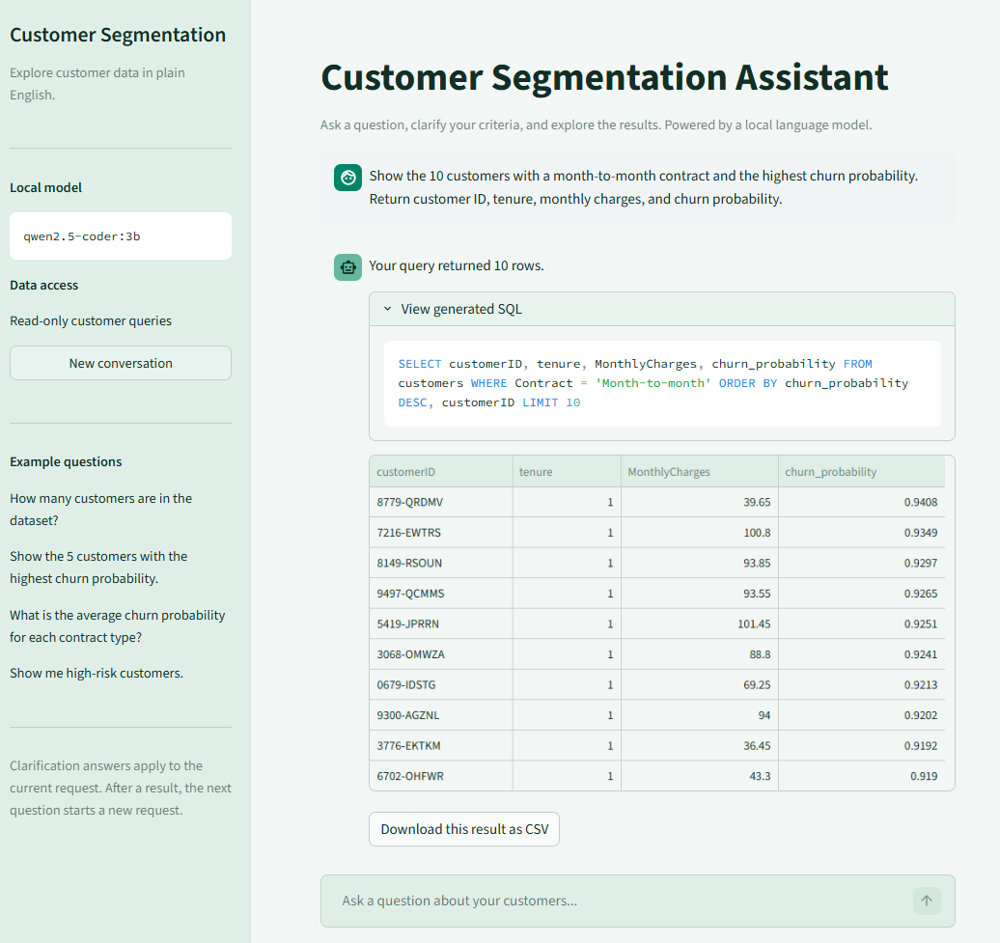
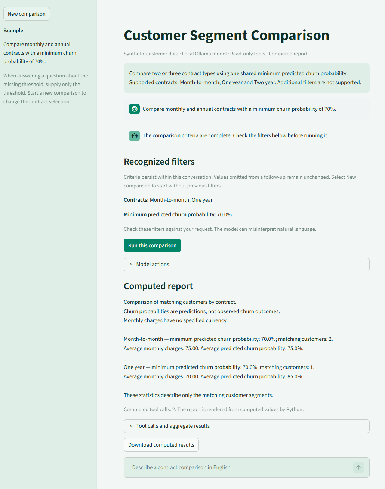
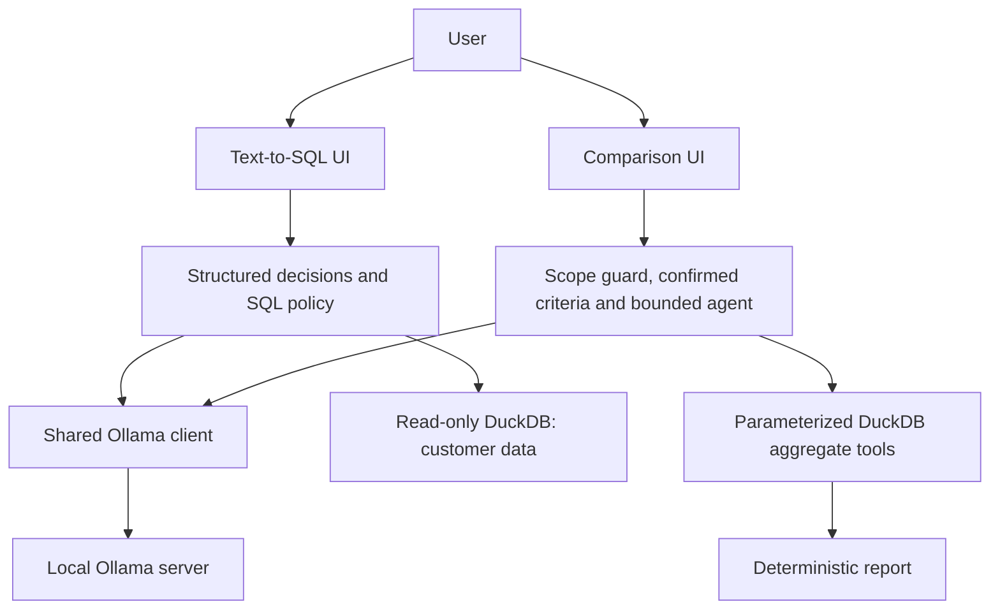

# Customer Segmentation Assistant

Local AI-powered customer analytics with natural-language queries,
controlled tool execution and transparent, computed results.

This portfolio project demonstrates two complementary approaches to connecting
local language models to structured customer data:

- **Text-to-SQL Assistant:** explore customer data using validated read-only SQL,
  clarify ambiguous requests, inspect queries and download results.
- **Bounded Segment Comparison:** compare customer groups through confirmed
  criteria, restricted tool calls, visible model actions and deterministic reports.

Both applications use Ollama, DuckDB and Streamlit. No external LLM API account,
API key, cloud infrastructure or upstream churn service is required for the demos.

## Key capabilities

| Capability | Text-to-SQL | Segment Comparison |
| --- | --- | --- |
| Natural-language input | Yes | Yes |
| Clarification questions | Yes | Yes |
| Read-only data access | Yes | Yes |
| SQL | Generated and validated | Fixed and parameterized |
| Explicit execution confirmation | No | Yes |
| Bounded model-selected actions | No | Yes |
| Inspectable execution | SQL and result table | Filters, actions and tool observations |
| Numerical results | Computed by DuckDB | Computed by DuckDB |
| Downloads | CSV | JSON |
| Docker support | Yes | Yes |

## Quick start with Docker

Requirements: Docker with Compose, internet access for initial downloads,
and enough memory and disk space for the selected models. The defaults use
approximately 11 GB of model storage in addition to container images and data.

From the repository root:

```bash
docker compose up --build -d
```

| Application | Open locally | Dataset | Default model |
| --- | --- | --- | --- |
| Text-to-SQL | [localhost:8502](http://localhost:8502) | 300 fictional customers | `qwen2.5-coder:3b` |
| Comparison | [localhost:8503](http://localhost:8503) | 6 fictional customers | `qwen2.5:14b` |

The first startup downloads models sequentially. Check progress with:

```bash
docker compose logs -f model-init comparison-model-init
docker compose ps -a
```

Both apps share one Ollama server, with separate datasets and model settings.
The default Docker configuration uses CPU inference. On slower hardware,
avoid concurrent requests; the larger comparison model may take longer to load.

Stop the environment with:

```bash
docker compose down
```

Named volumes preserve downloaded models and databases.
For local installation, model selection, configurable timeouts and troubleshooting,
see [Installation and configuration](docs/getting-started.md).

## Application demos

### 1. Text-to-SQL Assistant

Ask questions such as:

```text
How many customers are in the dataset?
```

Expected result in the synthetic demo: **300 customers**.

```text
What is the average churn probability for each contract type?
```

The assistant proposes a structured query, clarification or unsupported decision.
Python validates SQL before read-only execution. Generated SQL remains visible,
and the resulting table can be downloaded as CSV.



The screenshot uses the original scored development dataset, not the 300-customer
synthetic demo. Additional screenshots and clarification examples are in
[Application usage](docs/usage.md).

Risk categories have no predefined thresholds. For example, asking for
high-risk customers may trigger a request for an explicit minimum probability.
After a completed query, a new question starts an independent request.

### 2. Bounded Segment Comparison

Enter:

```text
Compare monthly and annual contracts with a minimum churn probability of 70%.
```

Review the recognized filters and select **Run this comparison**.

| Contract | Customers | Average monthly charges | Average predicted churn probability |
| --- | ---: | ---: | ---: |
| Month-to-month | 2 | 75.00 | 75% |
| One year | 1 | 70.00 | 85% |

These values come from the six-customer synthetic fixture. No currency is specified.



The model extracts criteria and selects actions from a state-dependent schema.
Python validates scope, limits execution and renders the report from computed
aggregates. A deterministic scope guard rejects known unsupported requirements
before model inference; additional requirements are checked during extraction.

The comparison is intentionally narrow: two or three supported contract types,
one shared inclusive minimum predicted churn probability, customer counts and
average monthly charges and predicted probabilities. It is not an autonomous analyst.

## Architecture



Language interpretation is separated from validation, data access and numerical
computation. The shared client centralizes model requests, timeout configuration
and typed communication errors. The criteria module centralizes contract and
probability validation without model or database dependencies.

The model does not receive individual query result rows. Comparison planning
receives computed aggregate observations only.

See [Architecture and implementation](docs/architecture.md) for detailed flows,
package responsibilities and execution safeguards.

## Technology stack

Python 3.12 · Ollama · Streamlit · DuckDB · SQLGlot · pandas · PyArrow · uv ·
Docker Compose · pytest · Ruff · GitHub Actions.

The comparison loop is implemented directly in Python without an external
agent framework.

## Testing and evaluation

Automated software tests do not require live model inference:

```bash
uv sync --locked --dev
uv run ruff check src tests scripts streamlit_app.py streamlit_agent_demo.py
uv run pytest -q
```

Latest validation: 2026-11-27.

| Validation | Model | Result |
| --- | --- | --- |
| Automated tests | Not required | 296 passed |
| Streamlit integration tests (included above) | Not required | 18/18 |
| Text-to-SQL reference evaluation | `qwen2.5-coder:3b` | 9/9 |
| Single-segment tool decisions | `qwen2.5-coder:3b` | 7/7 |
| Comparison clarification | `qwen2.5:14b` | Passed |
| Comparison end-to-end | `qwen2.5:14b` | 8/8 |
| Docker build and health checks | Not required | Passed |
| Docker deterministic smoke tests | Not required | Both passed |
| Docker functional verification | Both default models | Passed |

Both containerized applications were verified with their configured language
models, including clarification, SQL execution, controlled tool execution,
unsupported requirement rejection and computed comparison reporting.

These are small development reference suites, not independent accuracy benchmarks.

GitHub Actions is configured to run the automated test suite and independent
container smoke tests for both applications without live model inference.

See [Testing, CI and model evaluation](docs/evaluation.md) for commands,
detailed results and evaluation methodology.

## System scope and design boundaries

- Text-to-SQL supports one customer table; joins, subqueries and writes are not permitted.
- Generated SQL and extracted criteria can misinterpret user intent.
- Comparison supports a fixed analytical scope; additional filters and different segment thresholds are unsupported.
- Predicted churn probabilities are not observed churn outcomes.
- Synthetic scores and retention values are demonstration inputs, not trained model outputs.
- This is a local portfolio prototype, not a production-ready or multi-tenant service.

See [System scope and production readiness](docs/scope.md).

## Documentation

| Document | Contents |
| --- | --- |
| [Getting started](docs/getting-started.md) | Docker, local setup, model settings and troubleshooting |
| [Architecture](docs/architecture.md) | Execution flows, package structure and safeguards |
| [Usage](docs/usage.md) | Example requests, clarification, SQL scope, CLI and exports |
| [Data](docs/data.md) | Synthetic fixtures, scored export and import instructions |
| [Evaluation](docs/evaluation.md) | Tests, smoke checks, CI and live-model reference results |
| [System scope](docs/scope.md) | Functional boundaries and production considerations |

## Case studies

- [English case study](docs/llm_customer_segmentation_case_study_en.pdf)
- [Deutsche Projektübersicht](docs/llm_customer_segmentation_case_study_de.pdf)

The existing case studies describe the original Text-to-SQL application, not the
later bounded comparison workflow.

This independent reference project provides a foundation for specialized customer
analytics and AI-assisted data workflows, emphasizing controlled execution,
inspectable results and reproducible local deployment.
