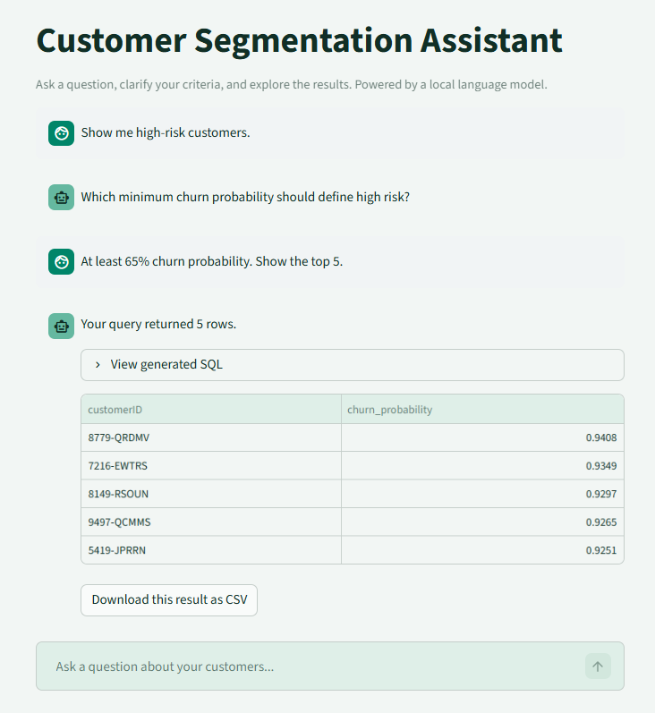
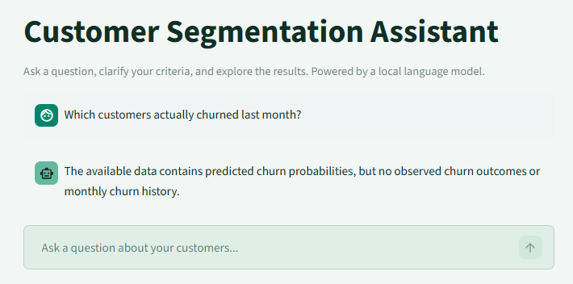
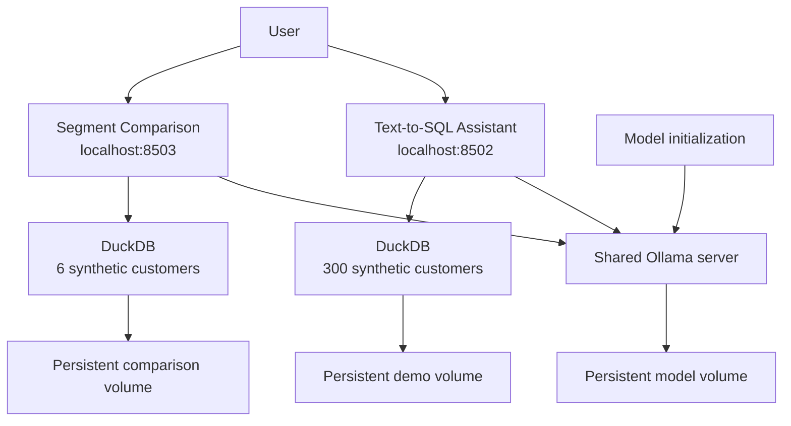
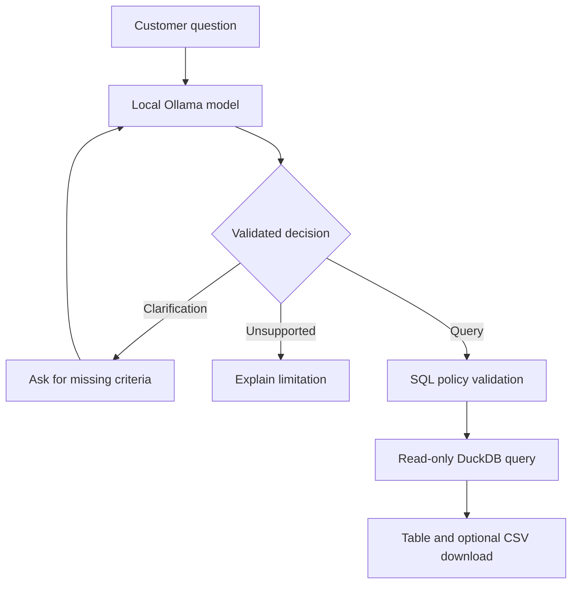
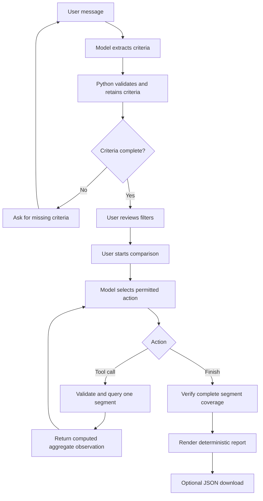

# Customer Segmentation Assistant

Local AI-powered customer analytics with natural-language queries,
controlled tool execution and transparent results.

The project demonstrates two complementary approaches to working with
customer data using Ollama, DuckDB and Streamlit:

- **Text-to-SQL Assistant:** explore customer segments through natural
  language, clarify ambiguous requests, inspect generated SQL and
  download query results.
- **Bounded Segment Comparison:** compare customer groups through
  validated tools, confirmed criteria, visible model actions and
  deterministically computed reports.

Both applications run locally. No external LLM API account, API key
or cloud infrastructure is required.

## Key capabilities

| Capability | Text-to-SQL Assistant | Segment Comparison |
| --- | --- | --- |
| Natural-language input | Yes | Yes |
| Clarification questions | Yes | Yes |
| Read-only data access | Yes | Yes |
| Generated SQL inspection | Yes | Fixed parameterized SQL |
| Explicit criteria confirmation | No | Yes |
| Controlled agent loop | No | Yes |
| Visible tool execution | No | Yes |
| Deterministic result computation | Yes | Yes |
| Downloadable results | CSV | JSON |
| Docker support | Yes | Yes |

## Quick start with Docker

The self-contained Docker environment includes both applications,
a shared Ollama server and separate synthetic datasets.

### Requirements

- Docker Desktop or Docker Engine with Docker Compose
- Internet access for the initial image and model downloads
- Sufficient local memory and storage for the language model

No local Python installation, Ollama installation or upstream
churn prediction project is required.

### Start

From the repository root:

```bash
docker compose up --build -d
```

Once startup completes, open:

| Application | URL | Demo dataset |
| --- | --- | --- |
| Text-to-SQL Assistant | http://localhost:8502 | 300 synthetic customers |
| Segment Comparison | http://localhost:8503 | 6 synthetic customers |

Both applications use the same Ollama container and language model.

The first startup downloads the required container images, Python
dependencies and language model. The applications wait until the
model initialization has completed successfully.

This configuration uses CPU inference. Response times depend on
hardware, model size and current system load.

Check startup progress:

```bash
docker compose logs -f model-init
docker compose ps
```

Application logs:

```bash
docker compose logs -f app comparison
```

### Try the Text-to-SQL Assistant

Enter:

```text
How many customers are in the dataset?
```

Expected result: **300 customers**.

Another example:

```text
What is the average churn probability for each contract type?
```

### Try the Segment Comparison

Enter:

```text
Compare monthly and annual contracts with a minimum churn probability of 70%.
```

Review the recognized filters and select **Run this comparison**.

Expected results:

| Contract | Matching customers | Average monthly charges | Average predicted churn probability |
| --- | ---: | ---: | ---: |
| Month-to-month | 2 | 75.00 | 75% |
| One year | 1 | 70.00 | 85% |

The results are calculated from the bundled synthetic fixture.
No currency is specified.

### Stop

```bash
docker compose down
```

Downloaded models and demo databases persist in named Docker volumes.

### Change the language model

The default model is:

```text
qwen2.5-coder:3b
```

To use a different model:

```bash
OLLAMA_MODEL=qwen2.5:14b docker compose up --build -d
```

Alternatively, define `OLLAMA_MODEL` in a local `.env` file.

Larger models require more memory and may significantly increase
response times.

The Docker environment uses its own Ollama server rather than an
existing Ollama installation on the host.

Both web interfaces are published on the host loopback interface.
The Ollama API is not published directly to the host.

## Application demos

### 1. Text-to-SQL Assistant

Explore customer data using natural-language questions without
writing SQL manually.

The assistant can:

- Filter customers by available attributes.
- Identify customers with high predicted churn probabilities.
- Calculate grouped statistics.
- Ask for missing or ambiguous criteria.
- Display generated SQL and query results.
- Export results as CSV.
- Explain when requested information is unavailable.

The following screenshots use the original scored development
dataset. Customer IDs, counts and values differ from the
self-contained Docker demo.

Both datasets use the same application interface.

#### Explore customer segments

Ask for customers with specific contract types, churn probabilities,
monthly charges, tenure or other supported attributes.

The interface displays the generated SQL alongside the query result.


#### Clarify ambiguous requests

Risk categories do not have predefined thresholds.

Example dialogue:

- **Question:** Show me high-risk customers.
- **Clarification:** Which minimum churn probability should define high risk?
- **Answer:** At least 65% churn probability. Show the top 5.
- **Result:** The five highest-scoring customers whose predicted churn
  probability is at least 65%.



#### Explain data limitations

The assistant distinguishes predicted churn probabilities from
observed churn events.

When a request requires unavailable information, it explains
the limitation rather than presenting unsupported results.



### 2. Bounded Segment Comparison

The comparison application demonstrates a controlled,
tool-using AI workflow.

Instead of generating arbitrary SQL, the model extracts comparison
criteria and selects permitted actions within a Python-controlled
execution loop.

The application supports:

- Natural-language comparison requests.
- Clarification of missing thresholds.
- Criteria retained across follow-up messages.
- Visible filters before execution.
- Explicit user confirmation.
- Restricted and validated tool calls.
- Deterministic aggregate calculations.
- Inspectable model actions and tool observations.
- Python-generated reports.
- JSON downloads.


The comparison uses a small synthetic dataset designed for exact
verification of customer counts, averages and empty segments.

It is a deliberately constrained example of an agent workflow,
not a general-purpose autonomous analyst.

## Case studies

Download the project onepager:

- [English case study](docs/llm_customer_segmentation_case_study_en.pdf)
- [Deutsche Projektübersicht](docs/llm_customer_segmentation_case_study_de.pdf)

The case studies describe the original Text-to-SQL application.
The bounded comparison workflow is documented separately in this
README and is not covered by the existing case studies.

## Architecture

### Docker deployment



Both applications use the same project image configuration and
share the Ollama server.

Their datasets are stored separately in persistent volumes.

The model initialization service downloads the configured language
model before the applications start.

### Text-to-SQL execution flow



The language model interprets the user's request and proposes
a structured decision.

Python validates the decision and generated SQL before DuckDB
executes the query.

The model does not calculate the returned metrics or generate
customer result rows.

Individual customer records are queried locally and are not
included in the model prompt.

#### Decision types

| Decision | Behavior |
| --- | --- |
| `query` | Validate and execute generated SQL |
| `clarification` | Request missing criteria |
| `unsupported` | Explain unavailable data or unsupported capabilities |

### Bounded comparison execution flow



The comparison workflow separates language understanding from
data access, execution control and numerical computation.

| Responsibility | Implementation |
| --- | --- |
| Interpret natural language | LLM |
| Extract comparison criteria | LLM |
| Retain conversation criteria | Python |
| Validate supported comparison scope | Python |
| Select a permitted next action | LLM |
| Restrict available actions | Python |
| Execute aggregate queries | DuckDB |
| Verify execution completeness | Python |
| Generate the final report | Python |

The model receives computed aggregate observations after each
tool call. It does not receive individual customer rows in
the comparison loop.

#### Controlled tool execution

Python restricts the available action schema according to
the current execution state:

- While segments remain, only a tool call for an outstanding
  contract is permitted.
- When all segments have been queried, only the completion
  signal is permitted.

Independent execution checks reject:

- Duplicate segment queries.
- Out-of-scope actions.
- Invalid tool arguments.
- Premature completion.
- Exceeded execution limits.

The interface permits at most four tool calls.

With this configuration, the loop permits at most five
planner calls, including completion.

Each model request uses a 180-second network timeout.
This is not a total workflow deadline.

#### Deterministic reporting

The final report is rendered by Python from computed
aggregate values.

An earlier free-text reporting experiment produced incorrect
comparisons and invented currency information. That experiment
is not used to generate comparison reports.

For this fixed comparison task, deterministic orchestration
could execute the same queries without model-based action
selection.

The model-selected query order does not provide an analytical
advantage. The purpose of this implementation is to demonstrate
controlled tool execution, state-dependent actions and
verifiable completion.

## Technology stack

| Component | Technology |
| --- | --- |
| Programming language | Python 3.12 |
| Default language model | `qwen2.5-coder:3b` |
| Local model serving | Ollama |
| Web interfaces | Streamlit |
| Database and query engine | DuckDB |
| SQL parsing and validation | SQLGlot |
| Data handling | pandas and PyArrow |
| Agent orchestration | Python and validated tool dispatch |
| Dependency management | uv |
| Containerization | Docker and Docker Compose |
| Testing | pytest |
| Linting and formatting | Ruff |
| Continuous integration | GitHub Actions |

The bounded comparison loop is implemented directly in Python,
without an external agent framework.

## Data

The project supports three independent datasets.

| Dataset | Records | Purpose |
| --- | ---: | --- |
| Original scored customer export | 6,734 | Text-to-SQL development and portfolio screenshots |
| Synthetic Text-to-SQL demo | 300 | Self-contained Docker and local demo |
| Synthetic comparison fixture | 6 | Controlled and exactly verifiable segment comparisons |

### Synthetic Text-to-SQL dataset

The self-contained demo contains 300 reproducible fictional
customers generated with seed 42.

It includes:

- The complete Text-to-SQL customer schema.
- Three contract types.
- Customer tenure and monthly charges.
- Synthetic churn probabilities.
- Illustrative retention actions and estimated values.
- Missing values for selected attributes.
- Synthetic scoring and model metadata.

The dataset is generated by:

```text
src/customer_segmentation_assistant/text_sql_demo.py
```

Default database:

```text
data/text_sql_demo.duckdb
```

The generator creates the database in a temporary directory
before publishing the completed file.

Existing databases are not overwritten. The command-line
entry point reuses an existing database on subsequent starts.

Scores, recommended actions and estimated values are artificial
demonstration inputs, not outputs from a trained model.

The interface explicitly identifies this dataset as synthetic.

### Original scored customer dataset

The original Text-to-SQL development dataset contains
6,734 customer records exported from a separate churn
prediction project.

Customer attributes are combined with:

- Predicted churn probability.
- Recommended retention action.
- Estimated customer value.
- Estimated action value.
- Scoring timestamp.
- Model name and version.
- Training run ID.
- Serving release ID.

The recorded development export uses model version 5 of:

```text
churn-prediction-model-dev
```

The observed `Churn` label is excluded.

Ten records have missing `TotalCharges` values represented
as SQL NULL.

The project does not evaluate the predictive performance
of the upstream churn model.

Once exported, the dataset can be used without running
the upstream churn prediction service.

The dataset is not bundled with this repository.

Default database:

```text
data/customers.duckdb
```

### Synthetic comparison fixture

The comparison demo uses six synthetic customers with
four columns:

- `customerID`
- `Contract`
- `MonthlyCharges`
- `churn_probability`

The fixture is defined in:

```text
src/customer_segmentation_assistant/demo_data.py
```

| Customer | Contract | Monthly charges | Predicted churn probability |
| --- | --- | ---: | ---: |
| demo-001 | Month-to-month | 60.00 | 80% |
| demo-002 | Month-to-month | 90.00 | 70% |
| demo-003 | Month-to-month | 30.00 | 20% |
| demo-004 | One year | 50.00 | 65% |
| demo-005 | One year | 70.00 | 85% |
| demo-006 | Two year | 40.00 | 10% |

Default database:

```text
data/agent_demo.duckdb
```

The fixture is intentionally small to support exact checks of
counts, averages, threshold boundaries and empty segments.

It is not intended for realistic statistical inference.

Generated datasets, databases, exports and local evaluation
results are excluded from Git.

## Local installation without Docker

Both applications can also be run directly using a local
Python environment and Ollama installation.

### Requirements

- Python 3.12
- uv
- Ollama

Run all commands from the repository root.

### 1. Install dependencies

```bash
uv sync
```

### 2. Prepare Ollama

Install Ollama using the
[official instructions](https://ollama.com/).

Download the default model:

```bash
ollama pull qwen2.5-coder:3b
```

If Ollama is not already running as a service:

```bash
ollama serve
```

Check availability:

```bash
curl --fail --show-error http://localhost:11434/api/tags
```

### 3. Run the synthetic Text-to-SQL demo

Create the reproducible demo dataset:

```bash
uv run python -m customer_segmentation_assistant.text_sql_demo
```

Start the application:

```bash
CUSTOMER_DATABASE=data/text_sql_demo.duckdb \
SYNTHETIC_DEMO=1 \
uv run streamlit run streamlit_app.py \
  --server.address 127.0.0.1 \
  --server.port 8502
```

Open http://localhost:8502.

The generator reuses an existing database.

To regenerate the dataset, stop the application and remove
only `data/text_sql_demo.duckdb` before running the generator
again.

### 4. Run the bounded comparison demo

In a separate terminal:

```bash
uv run streamlit run streamlit_agent_demo.py \
  --server.address 127.0.0.1 \
  --server.port 8503
```

Open http://localhost:8503.

The comparison database is created automatically when the
first comparison is executed, if it does not already exist.

No upstream churn dataset is required.

### 5. Optional: use an upstream scored customer export

Place a compatible customer export at:

```text
data/customer_segmentation.parquet
```

The required columns are described in:

```text
src/customer_segmentation_assistant/prompts.py
```

Import the dataset into DuckDB:

```bash
uv run python - <<'PY'
from pathlib import Path

import duckdb

source = Path("data/customer_segmentation.parquet")
database = Path("data/customers.duckdb")

if not source.is_file():
    raise SystemExit(f"Missing dataset: {source}")

if database.exists():
    raise SystemExit(f"Database already exists: {database}")

database.parent.mkdir(parents=True, exist_ok=True)

with duckdb.connect(str(database)) as connection:
    connection.execute(
        "CREATE TABLE customers AS SELECT * FROM read_parquet(?)",
        [str(source)],
    )
    count = connection.execute(
        "SELECT COUNT(*) FROM customers"
    ).fetchone()[0]

print(f"Created {database} with {count} customers.")
PY
```

Start the application:

```bash
uv run streamlit run streamlit_app.py \
  --server.address 127.0.0.1 \
  --server.port 8502
```

Without `CUSTOMER_DATABASE`, the Text-to-SQL application
uses `data/customers.duckdb`.

## Configuration

| Environment variable | Default | Purpose |
| --- | --- | --- |
| `OLLAMA_MODEL` | `qwen2.5-coder:3b` | Language model |
| `OLLAMA_BASE_URL` | `http://localhost:11434` | Ollama server address |
| `CUSTOMER_DATABASE` | `data/customers.duckdb` | Text-to-SQL database |
| `SYNTHETIC_DEMO` | Unset | Enable synthetic-data notice when set to `1` |

All model integrations use the shared Ollama configuration.

Within Docker, both applications connect to:

```text
http://ollama:11434
```

The Docker Text-to-SQL service selects the generated
300-customer database and enables the synthetic-data notice.

### Shared application theme

Both Streamlit interfaces use a common visual configuration.

| File | Responsibility |
| --- | --- |
| `.streamlit/config.toml` | Native Streamlit theme and component colors |
| `src/customer_segmentation_assistant/ui_theme.py` | Shared typography and chat styling |

The visual theme is independent of query execution,
model interaction and comparison logic.

## Using the Text-to-SQL Assistant

### Example questions

```text
How many customers are in the dataset?
```

```text
Show the 10 customers with a month-to-month contract and the highest churn probability. Return customer ID, tenure, monthly charges, and churn probability.
```

```text
What is the average churn probability for each contract type?
```

```text
How many customers have been with the company for at least 24 months and have a churn probability below 20%?
```

```text
How many customers have missing total charges?
```

### Clarification workflow

Ask:

```text
Show me high-risk customers.
```

When prompted, answer:

```text
At least 65% churn probability. Show the top 5.
```

The assistant combines the original request with the
clarification answer.

Up to three clarification answers are accepted for one request.

After a completed query, the next question starts a new request.
References to previous results, such as "show more of those",
are not supported.

Select **New conversation** to clear the displayed conversation
and pending clarification context.

Conversation history is stored in Streamlit session state
rather than durable storage.

### Result-limit enforcement

Risk thresholds must be explicitly supplied by the user.

Without an explicit customer count, the application returns
all matching customers.

Python removes the model-generated LIMIT and applies the
count recognized from the customer's messages.

Supported English count phrases include:

- `top 5`, `bottom 5`, `first 5`, `last 5`
- `show 5 customers`
- `return 5 rows`
- `limit to 5`
- `all matching customers`
- `no limit`

A count supplied before clarification is retained unless a
later customer message supplies a different count or explicitly
requests all matching results.

Assistant clarification messages are excluded from count
extraction.

Conflicting counts within one message trigger clarification.

Spelled-out numbers such as `five` and unsupported count
formulations are not recognized by this rule.

This mechanism controls result counts only. Filter
interpretation, selected columns and ranking direction
still depend on generated SQL.

### Inspect and download results

Expand **View generated SQL** to inspect the generated query.

Select **Download this result as CSV** to download the
displayed result.

CSV content is prepared in memory. The web interface does not
automatically write result exports into the project directory.

### Supported SQL scope

The Text-to-SQL policy permits:

- A single SELECT against the unqualified `customers` table.
- Column selection and aliases.
- Comparisons and logical filters.
- NULL checks.
- IN, BETWEEN and LIKE.
- COUNT, AVG, SUM, MIN and MAX.
- GROUP BY.
- ORDER BY.
- DISTINCT.
- LIMIT.

Unsupported operations include:

- Joins.
- Subqueries.
- Common table expressions.
- Unions.
- Window functions.
- External data sources.
- Unsupported SQL functions.
- Data modification.

Queries execute through read-only DuckDB connections.

SQL validation restricts permitted operations but does not
guarantee that a generated query represents the user's intent.

Generated SQL remains visible for inspection.

## Using the bounded comparison demo

### Supported comparison scope

The comparison application supports:

- Two or three explicitly named contract types.
- One shared inclusive minimum predicted churn probability.
- Customer counts.
- Average monthly charges.
- Average predicted churn probabilities.

Supported contract types:

```text
Month-to-month
One year
Two year
```

The comparison tool uses fixed parameterized aggregate SQL
rather than SQL generated by the model.

### Example dialogue

Enter:

```text
Compare monthly and annual contracts.
```

When prompted for the missing threshold:

```text
Use a minimum churn probability of 80%.
```

Review the recognized filters and select
**Run this comparison**.

Expected results for the bundled synthetic fixture:

| Contract | Matching customers | Average monthly charges | Average predicted churn probability |
| --- | ---: | ---: | ---: |
| Month-to-month | 1 | 60.00 | 80% |
| One year | 1 | 70.00 | 85% |

### Inspect execution

The interface provides:

- Recognized comparison criteria.
- An explicit execution button.
- Model actions.
- Aggregate tool observations.
- The computed report.
- Completed tool-call count.
- Downloadable JSON results.

Numerical results are computed by DuckDB and formatted by
Python rather than generated by the language model.

### Conversation behavior

Criteria persist within the comparison conversation.

Values omitted from a follow-up retain previous values.
A new message clears the previous report but does not
automatically clear the comparison criteria.

When at least two contracts are known and the threshold is
missing, a follow-up is treated as a threshold answer.
The existing contract selection is preserved.

Select **New comparison** to:

- Clear previous criteria.
- Reset the conversation.
- Remove previous model actions and reports.
- Start with a different contract selection.

New requests and follow-ups are not automatically
distinguished.

Results are queried only after the user selects
**Run this comparison**.

### Download results

Select **Download computed results** to download the
comparison result as JSON, including the associated
tool observations.

## Command-line interface

The CLI operates on the selected Text-to-SQL dataset.

Example:

```bash
uv run python -m customer_segmentation_assistant.cli \
  "How many customers are in the dataset?"
```

With the synthetic dataset:

```bash
CUSTOMER_DATABASE=data/text_sql_demo.duckdb \
uv run python -m customer_segmentation_assistant.cli \
  "Show the 5 customers with the highest churn probability."
```

Clarification example:

```bash
uv run python -m customer_segmentation_assistant.cli \
  "Show me high-risk customers."
```

Each invocation starts a new conversation.

For non-empty results, enter `y` to save a CSV file under
`data/exports/`, or press Enter to skip.

The exporter refuses to overwrite an existing destination.

## Validation and evaluation

The project separates automated software tests from live-model
evaluation.

Automated tests verify deterministic behavior. Live-model
evaluations additionally exercise natural-language interpretation
with a running Ollama model.

### Evaluation overview

| Validation | Reported result |
| --- | --- |
| Automated tests | 143 passed |
| Ruff linting | Passed |
| Text-to-SQL reference evaluation | 9/9 cases |
| Single-segment tool-decision evaluation | 7/7 automatic checks |
| Comparison end-to-end evaluation | 8/8 cases |
| Docker startup and health checks | Passed |
| Docker Text-to-SQL functional smoke test | Passed |
| Docker comparison functional smoke test | Passed |

The automated test count and Docker results reflect the
development state verified on 2026-11-26.

The live-model evaluation results are recorded development
results from earlier runs. They are not newly established
by the latest automated tests or Docker smoke tests.

### Automated checks

```bash
uv run ruff check src tests scripts \
  streamlit_app.py streamlit_agent_demo.py
```

```bash
uv run pytest -q
```

The test suite covers:

- Structured decision parsing.
- SQL policy enforcement.
- Read-only query behavior.
- Result-limit enforcement.
- Clarification state.
- Export behavior.
- Tool argument validation.
- Comparison criteria validation.
- State-dependent action restrictions.
- Tool-call limits.
- Deterministic result reporting.
- Synthetic dataset schema.
- Dataset reproducibility.
- Preservation of existing database files.
- Failed database creation without publishing incomplete files.

Automated tests do not establish general natural-language
accuracy.

### Text-to-SQL reference evaluation

```bash
uv run python scripts/evaluate_assistant.py
```

The previously recorded development run passed
9 of 9 reference cases.

Covered behaviors include:

- Customer counts.
- Combined filters.
- Percentage thresholds.
- Missing values.
- Grouped aggregates.
- Ranked customer lists.
- Clarification follow-ups.

Query evaluation compares returned values while ignoring
output aliases.

Row order is checked when required.

Standalone clarification wording requires manual review.

Unsupported responses were checked manually and were not
included in these nine reference cases.

### Single-segment tool-decision evaluation

```bash
uv run python scripts/evaluate_tools.py
```

After separating criteria extraction from Python decision
logic, the recorded development run passed 7 of 7
automatic checks.

Clarification wording was additionally reviewed manually.

These cases evaluate single-segment decisions rather than
the complete comparison agent.

### Comparison clarification check

```bash
uv run python scripts/check_comparison_dialogue.py
```

This live-model check verifies that a threshold follow-up
preserves the previously selected contract types.

It requires a running Ollama model.

### Comparison end-to-end evaluation

```bash
OLLAMA_MODEL=qwen2.5:14b \
uv run python scripts/evaluate_comparison.py
```

The recorded development run on 2026-11-11 passed
8 of 8 cases using `qwen2.5:14b`.

Covered behaviors include:

- Two-contract comparisons.
- Three-contract comparisons.
- Empty segments.
- Threshold clarification.
- Rejection of unsupported tenure filters.
- Rejection of unsupported monthly-charge filters.
- Rejection of different per-segment thresholds.
- Rejection of additional filters in follow-up messages.

This result applies to the tested model and development cases.
It should not be interpreted as an 8/8 result for the smaller
default model.

### Docker verification

Both containerized interfaces were manually verified
on 2026-11-26 using the default model
`qwen2.5-coder:3b`.

Verified behavior:

- Successful model initialization.
- Healthy Ollama server.
- Healthy Text-to-SQL application.
- Healthy comparison application.
- Successful communication with the shared Ollama server.
- Text-to-SQL query returning the expected 300 customers.
- Comparison criteria extraction.
- Correct comparison of monthly and annual contracts
  with a 70% minimum churn probability.
- Two successful comparison tool calls.
- Correct deterministic comparison report.
- Creation and presence of the comparison DuckDB database.
- Reuse of the existing Text-to-SQL database.
- Shared application theme available inside Docker.

These smoke tests verify the exercised workflows.
They do not replace the complete live-model evaluation.

### Evaluation limitations

The reference cases informed prompt changes and implementation
decisions during development.

They constitute small development evaluation suites rather
than independent general-accuracy benchmarks.

Results depend on the tested model, model configuration,
dataset and evaluation cases.

Model responses, timings, dialogues, actions and evaluation
reports are saved under:

```text
data/evaluation/
```

Generated evaluation results are excluded from Git.

## Scope and limitations

### Text-to-SQL Assistant

- One supported customer table.
- One scored dataset per application instance.
- No joins or general multi-table analytics.
- No observed churn outcomes.
- No historical churn-event or score analysis.
- No external information retrieval.
- No predefined risk-category thresholds.
- No persistent conversation history.
- No follow-up modifications to completed queries.
- Generated SQL may misinterpret the user's intent.

### Bounded Segment Comparison

- English comparison requests.
- Two or three explicitly named supported contract types.
- One shared inclusive minimum churn threshold.
- No arbitrary additional filters.
- No different thresholds for individual segments.
- No general analytical requests.
- Specialized clarification handling rather than a
  general conversation engine.
- Natural-language extraction may omit or misinterpret
  requested criteria.
- Visible filters define the comparison actually executed.
- No durable conversation state.

### Project-wide limitations

- Local portfolio prototype, not a publicly deployed service.
- No production authentication or access-control system.
- No multi-tenant isolation.
- No autonomous customer contact.
- No campaign execution.
- No customer data modification.
- No retrieval-augmented generation.
- No multi-agent orchestration.
- No evidence of measured business impact from synthetic data.

Local response times depend on hardware, model loading,
prompt processing and system load.

Initial requests may take substantially longer than
subsequent requests.

Larger language models may improve some interpretation tasks
but require additional computational resources.

The project does not establish the predictive accuracy
of upstream churn scores.

Broader evaluation, access controls, operational monitoring
and deployment-specific security measures would be required
before production use.

The experimental model-written explanation in
`result_summary.py` is not used in the bounded comparison
report.

## Project structure

```text
customer-segmentation-assistant/
├── .streamlit/
│   └── config.toml
├── docs/
│   ├── images/
│   │   ├── customer-segmentation-query.png
│   │   ├── customer-segmentation-clarification.png
│   │   ├── customer-segmentation-data-boundaries.png
│   │   └── customer-segmentation-comparison.png
│   ├── llm_customer_segmentation_case_study_de.pdf
│   └── llm_customer_segmentation_case_study_en.pdf
├── evaluation/
│   ├── cases.json
│   ├── comparison_cases.json
│   └── tool_cases.json
├── scripts/
│   ├── check_comparison_dialogue.py
│   ├── evaluate_assistant.py
│   ├── evaluate_comparison.py
│   └── evaluate_tools.py
├── src/
│   └── customer_segmentation_assistant/
│       ├── agent.py
│       ├── cli.py
│       ├── comparison_conversation.py
│       ├── comparison_request.py
│       ├── conversation.py
│       ├── database.py
│       ├── decisions.py
│       ├── demo_data.py
│       ├── export.py
│       ├── llm.py
│       ├── prompts.py
│       ├── result_summary.py
│       ├── sql_policy.py
│       ├── text_sql_demo.py
│       ├── tool_dispatch.py
│       ├── tool_llm.py
│       ├── tools.py
│       └── ui_theme.py
├── tests/
├── .dockerignore
├── .gitignore
├── compose.yaml
├── Dockerfile
├── pyproject.toml
├── README.md
├── streamlit_agent_demo.py
├── streamlit_app.py
└── uv.lock
```

The tree focuses on the main application, configuration,
documentation and evaluation files.

### Core components

| Component | Responsibility |
| --- | --- |
| `streamlit_app.py` | Text-to-SQL browser interface |
| `streamlit_agent_demo.py` | Comparison interface and execution confirmation |
| `agent.py` | Bounded agent loop and deterministic reporting |
| `comparison_request.py` | Comparison criteria and scope extraction |
| `comparison_conversation.py` | Stateful comparison criteria |
| `conversation.py` | Single-segment clarification state |
| `database.py` | Read-only DuckDB query execution |
| `decisions.py` | Structured decision parsing |
| `llm.py` | Shared Ollama configuration and Text-to-SQL integration |
| `prompts.py` | Customer schema and model instructions |
| `sql_policy.py` | SQL validation and permitted operations |
| `tools.py` | Parameterized segment summary queries |
| `tool_dispatch.py` | Validated and allowlisted tool execution |
| `tool_llm.py` | Single-segment model-based extraction |
| `result_summary.py` | Isolated experimental model-written explanations |
| `text_sql_demo.py` | Reproducible 300-customer synthetic dataset |
| `demo_data.py` | Six-customer comparison fixture |
| `ui_theme.py` | Shared Streamlit styling |
| `cli.py` | Command-line interface |
| `export.py` | Result export |
| `evaluation/` | Development cases and expected results |
| `scripts/` | Live-model evaluation scripts |
| `tests/` | Automated software tests |
| `compose.yaml` | Self-contained local Docker deployment |

## Project context

This independent reference project demonstrates how local
language models can be connected to structured customer
data through controlled software interfaces.

It focuses on:

- Natural-language data access.
- Explicit handling of ambiguous and unsupported requests.
- Validated read-only query execution.
- Controlled model-based tool selection.
- Separation of language interpretation from numerical computation.
- Inspectable execution and results.
- Reproducible local deployment.
- Automated testing and development evaluation.

The project is intended as a technical portfolio reference
and a foundation for more specialized customer analytics
and AI-assisted data workflows.