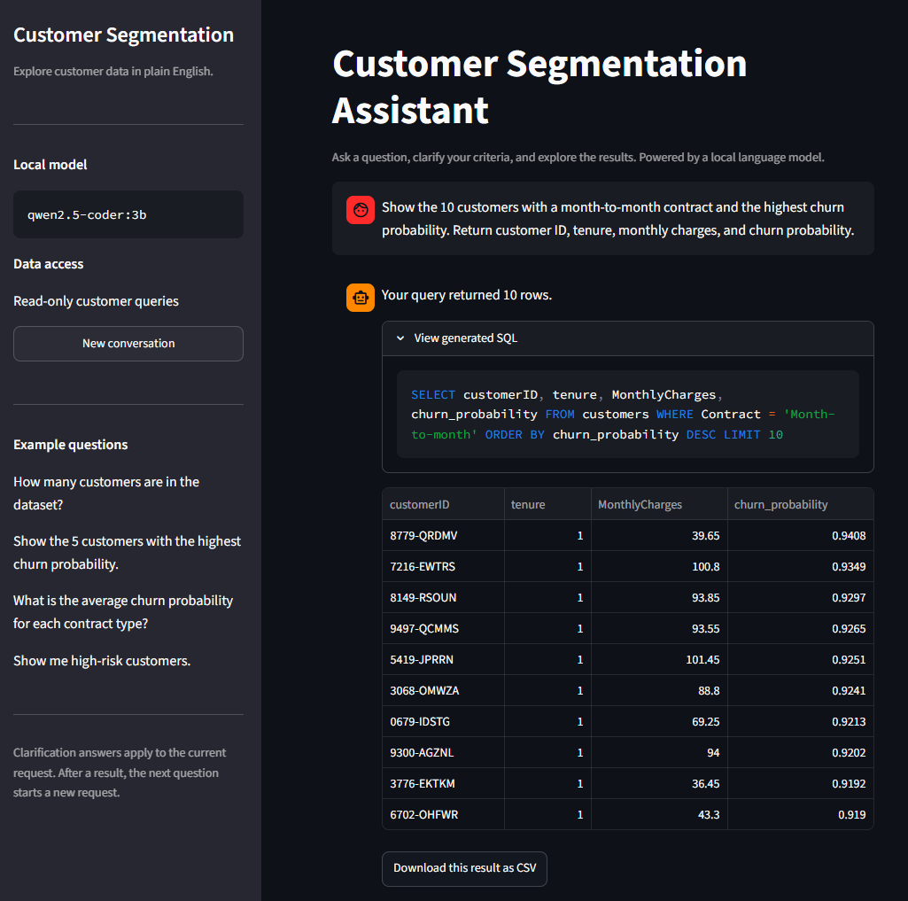
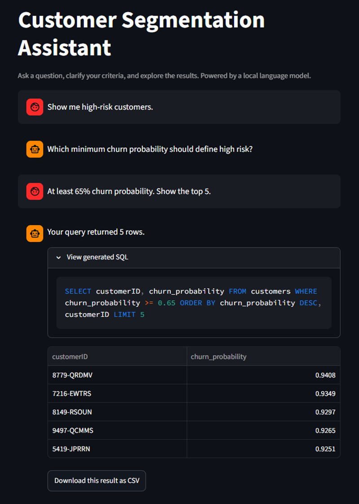
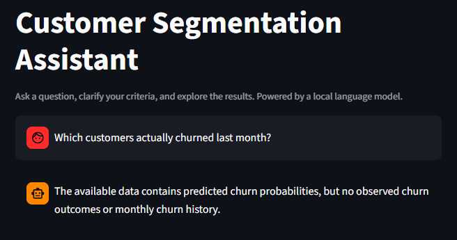
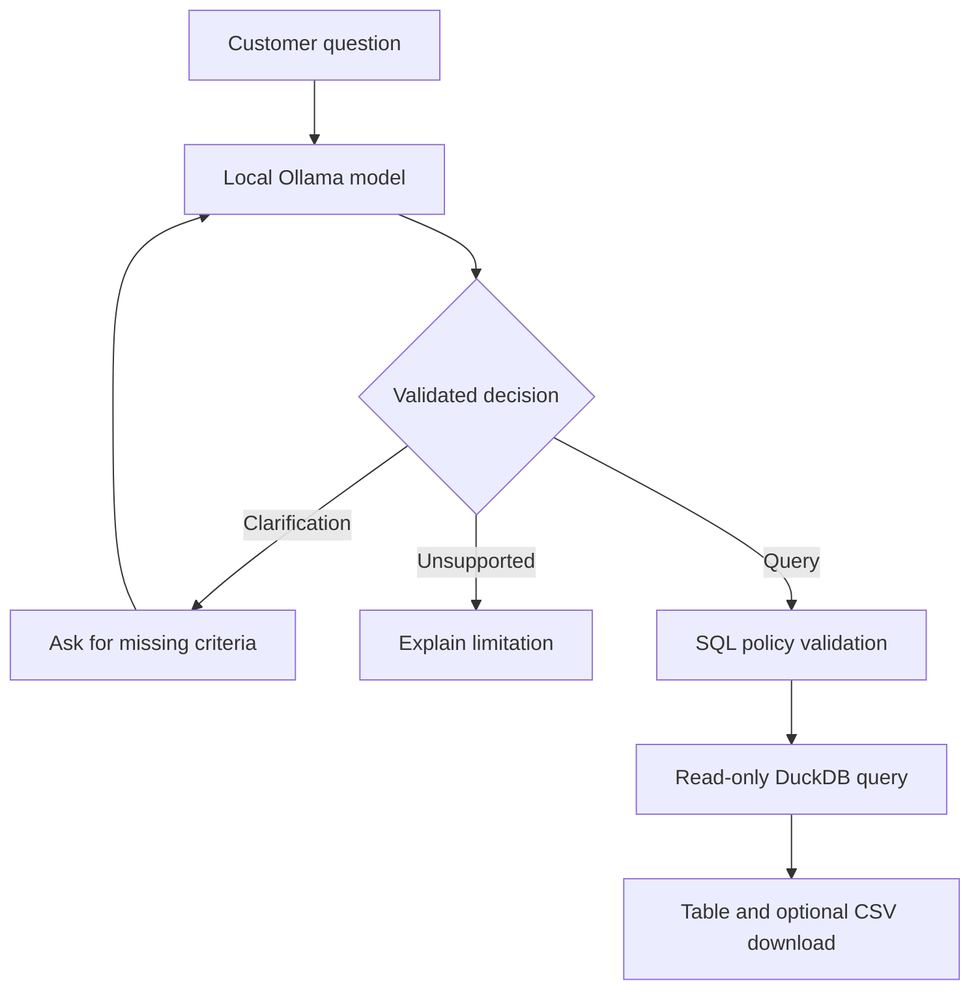
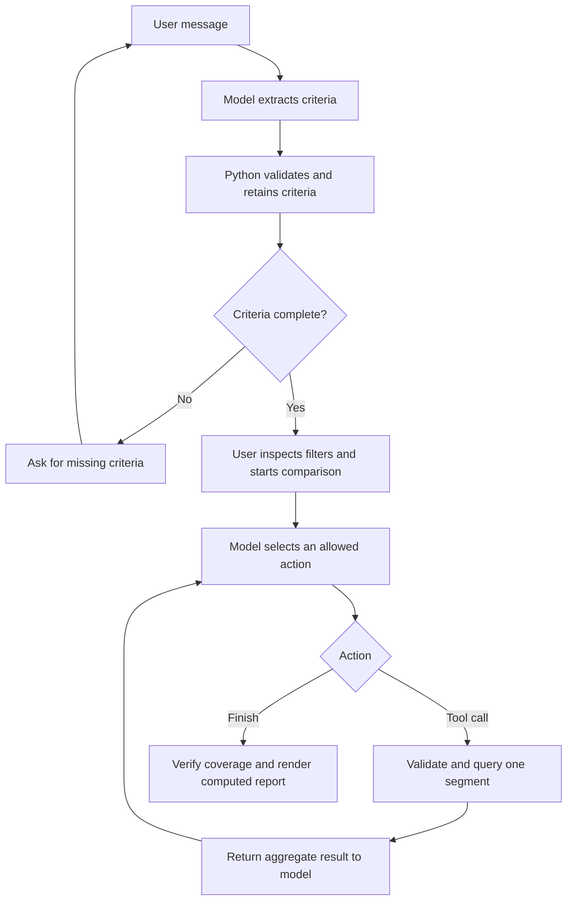

# Customer Segmentation Assistant

Explore customer segments through two local interfaces powered by Ollama,
DuckDB and Streamlit:

- **Text-to-SQL assistant:** ask questions about a scored customer dataset,
  clarify ambiguous criteria, inspect SQL and download query results.
- **Bounded comparison demo:** compare synthetic customer segments through
  validated tools, visible model actions and a computed report.

Both interfaces run locally. No external LLM API account is required.

## Quick start: self-contained Text-to-SQL demo

Install Docker Desktop (or Docker Engine with Compose), then run from this folder:

```bash
docker compose up --build -d
```

Open http://localhost:8502 once startup completes. First startup downloads the
Python dependencies and the Ollama model; allow time for this download.
The app waits for the model download before starting. No Python installation,
Ollama installation, API key or upstream churn project is needed on the host.
This configuration uses CPU inference; response times depend on your hardware.

```bash
docker compose logs -f model-init app
docker compose ps
```

Try “How many customers are in the dataset?” (expected: **300**) or
“What is the average churn probability for each contract type?”.

The dedicated demo database contains 300 reproducible fictional customers
(seed 42), all columns in the Text-to-SQL schema, three contract types and
missing values. Scores, actions and values are illustrative synthetic inputs,
not trained-model outputs. The UI labels this demo explicitly. The original
six-customer comparison fixture and upstream database are separate.

Stop with `docker compose down`. Model and demo data persist in named volumes.
To change the model, set `OLLAMA_MODEL` in your shell or in a local `.env` file,
then run the start command again. Models run inside Compose; an existing host
Ollama installation is not used. Only the web UI is published, on loopback.

### Run the same demo without Docker

Complete dependency and Ollama setup below, then:

```bash
uv run python -m customer_segmentation_assistant.text_sql_demo
CUSTOMER_DATABASE=data/text_sql_demo.duckdb SYNTHETIC_DEMO=1 uv run streamlit run streamlit_app.py --server.address 127.0.0.1 --server.port 8502
```

The generator reuses an existing database without overwriting it. To regenerate,
stop the local app and remove only `data/text_sql_demo.duckdb` before rerunning.
`OLLAMA_BASE_URL` defaults to `http://localhost:11434` for the Text-to-SQL app;
set it to use a different Ollama server.

## Choose an interface

| Interface | Entry point | Data | Model responsibility |
| --- | --- | --- | --- |
| Text-to-SQL assistant | `streamlit_app.py` | Compatible scored customer export | Propose SQL, a clarification or an unsupported response |
| Bounded comparison demo | `streamlit_agent_demo.py` | Six synthetic customers created locally | Extract criteria and select permitted next actions |

For the comparison demo, complete Setup steps 1–2 and follow
[Bounded comparison demo](#bounded-comparison-demo). No upstream churn export,
Docker containers or cloud infrastructure is required.

## Project onepager

- [English case study](docs/llm_customer_segmentation_case_study_en.pdf)
- [Deutsche Projektübersicht](docs/llm_customer_segmentation_case_study_de.pdf)

These case studies describe the original Text-to-SQL application. They do not
serve as evidence for the newer comparison demo.

## Text-to-SQL demo

The screenshots below show the original scored development dataset.
The Docker quick start uses a separate dataset of 300 synthetic customers,
so customer IDs, counts and values differ from the screenshots.
Both datasets use the same Text-to-SQL interface.

### Find customer segments

Ask for a customer segment using contract types, churn probabilities,
monthly charges, tenure or other available attributes. The interface displays
SQL alongside the query result.



### Clarify ambiguous requests

Risk categories have no predefined thresholds. For example:

- **Question:** Show me high-risk customers.
- **Clarification:** Which minimum churn probability should define high risk?
- **Answer:** At least 65% churn probability. Show the top 5.
- **Result:** The five highest-scoring customers whose predicted churn
  probability is at least 65%.



### Explain data limitations

The assistant distinguishes predicted churn risk from observed churn events.
When a question requires unavailable information, it explains the limitation.



## Text-to-SQL features

- Local browser-based chat interface and command-line interface
- English questions translated into structured decisions
- Clarification questions for ambiguous criteria
- Explicit responses for unsupported requests
- SQL validation before execution
- Read-only DuckDB connections
- Queries restricted to `customers` and a supported SQL subset
- Inspectable SQL and tabular results
- User-initiated CSV downloads
- Reference evaluation based on query results rather than SQL text

## How the Text-to-SQL assistant works

The model interprets a request and proposes a decision. For query decisions,
DuckDB executes the validated SQL and computes the result.



The model does not calculate returned metrics or generate result rows.
Customer records are queried locally and are not included in the model prompt.

### Decision types

| Type | Behavior |
| --- | --- |
| `query` | Validate the SQL and execute it against the customer database |
| `clarification` | Ask for missing criteria |
| `unsupported` | Explain that data or capabilities are unavailable |

### Customer-list behavior

- Risk thresholds must be supplied by the user.
- Without an explicit customer count, return all matching customers.
- Requests such as “top 5” apply the requested limit.
- Requests for “all” matching customers omit the limit.

### Result-limit enforcement

After SQL generation, Python removes the model-generated LIMIT and applies
the count recognized from the customer's messages.

Supported English count phrases use positive integers, for example:

- `top 5`, `bottom 5`, `first 5` or `last 5`
- `show 5 customers` or `return 5 rows`
- `limit to 5`
- `all matching customers` or `no limit`

A count supplied before a clarification is retained unless a later customer
message supplies a different count or explicitly requests all matching results.
Assistant clarification messages are excluded from count extraction.

If no supported count phrase is recognized, no LIMIT is applied.
Conflicting counts within one message trigger a clarification.
Spelled-out numbers such as `five` and other count formulations are not
recognized by this rule.

This check controls the result count only. Filter interpretation, selected
columns and ranking direction still depend on generated SQL. Inspect the SQL
to confirm that it represents your request.

## Technology

| Component | Technology |
| --- | --- |
| Default language model | `qwen2.5-coder:3b` |
| Local model serving | Ollama |
| Web interfaces | Streamlit |
| Query engine | DuckDB |
| SQL parsing and validation | SQLGlot |
| Data handling | pandas and PyArrow |
| Environment and dependencies | uv |
| Tests and linting | pytest and Ruff |
| Comparison orchestration | Python state, validated tool dispatch and state-dependent JSON schemas |

The comparison demo implements its loop directly in Python without an agent
framework. Backend model functions accept a model argument; the demo interface
uses the project default.

## Data

### Text-to-SQL dataset

Two data sources are available for the Text-to-SQL interface:

- **Synthetic demo:** generate 120 reproducible customers using
  `uv run python scripts/create_text_to_sql_demo.py`.
  This creates `data/text_to_sql_demo.duckdb` with all required columns.
  Scores, actions and estimated values are artificial demonstration inputs.
  Start the application with
  `CUSTOMER_DATABASE=data/text_to_sql_demo.duckdb` as shown in the quick start.
- **Upstream scored export:** use the customer dataset described below.
  This requires a separate export and database import.

The recorded development dataset contains **6,734 customer records** exported
from a separate churn prediction project. Customer attributes are combined with:

- Predicted churn probability
- Recommended retention action
- Estimated customer value and action value
- Scoring timestamp
- Model name, model version, training run ID and serving release ID

The recorded export uses model version **5** of `churn-prediction-model-dev`.
The observed `Churn` label is excluded. Ten records have missing `TotalCharges`
values, represented as SQL NULL.

These scores are demonstration inputs. This project does not evaluate the
predictive performance of the upstream model. Once exported, the dataset can
be used without running the upstream churn service.

### Synthetic comparison data

The comparison demo uses six synthetic customers with four columns:

- `customerID`
- `Contract`
- `MonthlyCharges`
- `churn_probability`

`demo_data.py` defines the records. They are designed for exact checks of
segment counts, averages and empty results, not for realistic statistical
inference. They are not a full replacement for the Text-to-SQL dataset.

| Database | Purpose |
| --- | --- |
| `data/customers.duckdb` | Original scored dataset for Text-to-SQL |
| `data/agent_demo.duckdb` | Synthetic comparison demo |

Customer datasets, databases, generated exports and local evaluation results
are excluded from Git. Existing demo databases are not automatically replaced
when the source fixture changes.

## Requirements

- Python 3.12
- uv
- Ollama with `qwen2.5-coder:3b` available
- For Text-to-SQL: either the generated synthetic demo dataset
  (see Quick start with synthetic data) or a compatible upstream scored
  customer export

The application expects Ollama at `http://localhost:11434`.

## Quick start with synthetic data

Try the complete Text-to-SQL interface without an upstream churn export.
Requires Python 3.12, uv and a running Ollama installation.

```bash
uv sync
ollama pull qwen2.5-coder:3b
uv run python scripts/create_text_to_sql_demo.py

CUSTOMER_DATABASE=data/text_to_sql_demo.duckdb \
uv run streamlit run streamlit_app.py \
  --server.address 127.0.0.1 \
  --server.port 8502
```

Open http://localhost:8502.

The generator creates 120 reproducible synthetic customers with all columns
required by the Text-to-SQL application. Scores, recommended actions and
estimated values are artificial demonstration inputs, not model predictions
or evidence of business impact. No currency is specified.

Example questions:

- How many customers are in the dataset?
- What is the average churn probability for each contract type?
- How many customers have missing total charges?

The first question returns 120 customers; the missing-values question returns 10.

The generator refuses to overwrite an existing destination.
`CUSTOMER_DATABASE` selects the database for both the web interface and CLI.
Without it, the application uses `data/customers.duckdb`.

The six-customer bounded comparison demo uses a separate database and fixture.

## Setup

Run commands from the repository root.

### 1. Install dependencies

```bash
uv sync
```

### 2. Prepare the local model

Install Ollama using [the official instructions](https://ollama.com/), then:

```bash
ollama pull qwen2.5-coder:3b
```

If Ollama is not already running as a service, use a separate terminal:

```bash
ollama serve
```

Check availability:

```bash
curl --fail --show-error http://localhost:11434/api/tags
```

For the synthetic comparison demo, continue to
[Bounded comparison demo](#bounded-comparison-demo). Steps 3–4 are for
Text-to-SQL only.

### 3. Provide the scored dataset

Place the upstream export at:

```text
data/customer_segmentation.parquet
```

It is not bundled with this repository. Required columns are described in:

```text
src/customer_segmentation_assistant/prompts.py
```

### 4. Create the Text-to-SQL database

Run once to import the Parquet dataset:

```bash
uv run python - <<'PY'
from pathlib import Path

import duckdb

source = Path("data/customer_segmentation.parquet")
database = Path("data/customers.duckdb")

if not source.is_file():
    raise SystemExit(f"Missing dataset: {source}")
if database.exists():
    raise SystemExit(f"Database already exists: {database}")

with duckdb.connect(str(database)) as connection:
    connection.execute(
        "CREATE TABLE customers AS SELECT * FROM read_parquet(?)",
        [str(source)],
    )
    count = connection.execute("SELECT COUNT(*) FROM customers").fetchone()[0]

print(f"Created {database} with {count} customers.")
PY
```

## Text-to-SQL web interface

```bash
uv run streamlit run streamlit_app.py \
  --server.address 127.0.0.1 \
  --server.port 8502
```

Open http://localhost:8502. Keep the terminal running.

### Example questions

```text
How many customers are in the dataset?
```

```text
Show the 10 customers with a month-to-month contract and the highest churn probability. Return customer ID, tenure, monthly charges, and churn probability.
```

```text
What is the average churn probability for each contract type?
```

```text
How many customers have been with the company for at least 24 months and have a churn probability below 20%?
```

### Clarification workflow

Ask `Show me high-risk customers.` and, when prompted, answer:

```text
At least 65% churn probability. Show the top 5.
```

The assistant combines the original request with the clarification answer.
Up to three clarification answers are accepted for one request.
After a completed query, the next question starts a new request. References
to previous results, such as “show more of those,” are not supported.

Use **New conversation** to clear the chat and pending clarification context.
History is kept in session state rather than durable storage.

### Inspect and download results

Expand **View generated SQL** to inspect the query. Select
**Download this result as CSV** to download the displayed result.
The interface prepares CSV content in memory; it does not automatically
write an export into the project directory.

## Bounded comparison demo

This learning demo compares two or three supported contract types using one
shared inclusive minimum predicted churn probability.

### Start

```bash
uv run streamlit run streamlit_agent_demo.py \
  --server.address 0.0.0.0 \
  --server.port 8503 \
  --server.headless true
```

Open http://localhost:8503. The demo creates `data/agent_demo.duckdb` when
it does not exist. No upstream churn export is required.

The address `0.0.0.0` allows connections through available network interfaces.
For a loopback-only local session, use `--server.address 127.0.0.1` instead.

### Example dialogue

1. Enter: `Compare monthly and annual contracts.`
2. Answer: `Use a minimum churn probability of 80%.`
3. Inspect the recognized contracts and threshold.
4. Select **Run this comparison**.
5. Inspect model actions, aggregate tool results and the computed report.

For the bundled synthetic data:

| Contract | Matching customers | Average monthly charges | Average predicted churn probability |
| --- | ---: | ---: | ---: |
| Month-to-month | 1 | 60.00 | 80% |
| One year | 1 | 70.00 | 85% |

No currency is specified. Predicted probabilities are not observed churn events.

### Execution flow



The model receives computed aggregate observations after each tool call.
It does not receive individual customer rows in this loop.

Python restricts the available action schema to the current state:

- While segments remain, only a tool call for an outstanding contract is allowed.
- When all segments have observations, only the completion signal is allowed.

Independent execution checks reject duplicate queries, out-of-scope actions
and premature completion. The UI permits at most four tool calls; the loop
permits at most five planner calls with that configuration. Each model request
uses a 180-second network timeout; this is not a total workflow deadline.

The final report is rendered by Python from computed values. An earlier
free-text experiment produced incorrect comparisons and invented currency;
that experiment is not used to generate comparison reports.

This is a deliberately constrained demonstration of an agent loop. For this
fixed comparison, deterministic orchestration could execute the same queries
without model-based action selection. Model-selected query order does not
provide an analytical advantage for this task.

### Conversation behavior

Criteria persist within the comparison conversation. Values omitted from a
follow-up retain previous values. A new message clears the previous report
but does not automatically clear the criteria.

When at least two contracts are known and the threshold is missing, a follow-up
is treated as a threshold answer: the contract selection is preserved.
Select **New comparison** to clear the conversation, filters, actions and report,
or to change contract selection while answering that threshold question.

New requests and follow-ups are not automatically distinguished. Results are
queried only after **Run this comparison** is selected. The result, including
tool observations, can be downloaded as JSON.

### Scope and limitations

- English requests for two or three explicitly named supported contract types.
- Supported values: `Month-to-month`, `One year` and `Two year`.
- One shared inclusive minimum predicted churn probability.
- Additional filters, different per-segment thresholds and general analytical
  requests are not supported.
- Natural-language extraction can be incorrect or silently omit unsupported
  criteria. Visible filters define what will actually be executed.
- Clarification handling is specialized, not a general conversation engine.
- Session state is not persisted durably.
- No customer contact, campaign execution or data modification is available.
- Synthetic results do not establish business impact or model accuracy.

## Command-line interface

The existing CLI operates on the Text-to-SQL dataset.

```bash
uv run python -m customer_segmentation_assistant.cli \
  "How many customers are in the dataset?"
```

```bash
uv run python -m customer_segmentation_assistant.cli \
  "Show the 5 customers with the highest churn probability."
```

```bash
uv run python -m customer_segmentation_assistant.cli \
  "Show me high-risk customers."
```

Each invocation starts a new conversation. For non-empty results, enter `y`
to save CSV under `data/exports/`, or press Enter to skip. The exporter refuses
to overwrite an existing destination.

## Validation and evaluation

### Automated checks

```bash
uv run ruff check src tests scripts streamlit_app.py streamlit_agent_demo.py
uv run pytest -q
```

The most recently reported development run passed **131 tests**. Coverage
includes structured parsing, SQL restrictions, export behavior, tool arguments,
clarification state, action restrictions, tool-call limits and computed reports.
Unit tests do not establish natural-language accuracy.

Both browser workflows have also been exercised manually. The comparison demo
was checked with clarification, visible filters, two tool calls, completion,
report output and conversation reset.

### Text-to-SQL reference evaluation

```bash
uv run python scripts/evaluate_assistant.py
```

The previously reported run passed **9 of 9 reference cases**, covering counts,
combined filters, percentage thresholds, missing values, grouped aggregates,
ranked lists and clarification follow-ups.

Query evaluation compares returned values while ignoring output aliases.
Row order is checked when required. Standalone clarification wording requires
manual review. Unsupported responses were checked manually, not in these nine
cases.

Several cases appear in the prompt or informed prompt changes. This is a small
development suite, not an independent general-accuracy benchmark. The nine-case
result has not been newly established by the comparison-demo tests.

### Single-segment tool-decision evaluation

```bash
uv run python scripts/evaluate_tools.py
```

After separating criteria extraction from Python decision logic, the observed
run passed **7 of 7 automatic checks**. Clarification wording was also reviewed
manually. The cases informed development and are not an independent benchmark.
They evaluate single-segment decisions, not complete comparison-agent behavior.

Model responses and timings are saved under `data/evaluation/` and excluded
from Git.

### Comparison clarification check

```bash
uv run python scripts/check_comparison_dialogue.py
```

This live-model check verifies that a threshold follow-up preserves the
previously selected contract types. It requires a running Ollama model.

### Comparison end-to-end evaluation

```bash
OLLAMA_MODEL=qwen2.5:14b uv run python scripts/evaluate_comparison.py
```

The development run on 2026-11-11 passed **8 of 8 cases**, covering
two- and three-contract comparisons, empty segments, threshold clarification,
and rejection of unsupported tenure filters, monthly-charge filters,
different per-segment thresholds and additional filters in follow-ups.

These cases informed development and are not an independent benchmark.
Results apply to the tested model and cases; they do not establish general
natural-language accuracy.

Full dialogues, actions and results are saved under `data/evaluation/`
and excluded from Git.

## Supported SQL scope

The original Text-to-SQL policy permits:

- A single SELECT against the unqualified `customers` table
- Column selection and aliases
- Comparisons and logical filters
- NULL checks, IN, BETWEEN and LIKE
- COUNT, AVG, SUM, MIN and MAX
- GROUP BY, ORDER BY, DISTINCT and LIMIT

Joins, subqueries, CTEs, unions, window functions, external sources and unsupported
functions are rejected. The comparison tool instead uses fixed parameterized
aggregate SQL; it does not execute SQL generated by the planner.

## Text-to-SQL limitations

- One customer table and one scored dataset
- No observed churn outcomes, event history or historical score analysis
- No external information retrieval
- No predefined risk-category thresholds
- No persistent conversation history
- No follow-up modifications to completed queries
- Local prototype, not a publicly deployed service

SQL validation and read-only access restrict operations but do not guarantee
that a query represents the user's intent. Generated SQL is displayed for
inspection.

## Project-wide limitations

Local latency depends on hardware, model loading, prompt processing and system
load. Initial requests can be substantially slower. The project does not
implement a general autonomous analyst, RAG, a multi-agent system or production
access control.

The interfaces are portfolio prototypes. Broader evaluation and operational
controls would be needed before production use. The model-written explanation
in `result_summary.py` remains an isolated experiment and is not used in the
comparison report.

## Project structure

```text
streamlit_app.py
streamlit_agent_demo.py
src/customer_segmentation_assistant/
    agent.py
    cli.py
    comparison_conversation.py
    comparison_request.py
    conversation.py
    database.py
    decisions.py
    demo_data.py
    export.py
    llm.py
    prompts.py
    result_summary.py
    sql_policy.py
    tool_dispatch.py
    tool_llm.py
    tools.py
evaluation/
    cases.json
    comparison_cases.json
    tool_cases.json
scripts/
    check_comparison_dialogue.py
    create_text_to_sql_demo.py
    evaluate_assistant.py
    evaluate_comparison.py
    evaluate_tools.py
tests/
docs/images/
```

| File | Purpose |
| --- | --- |
| `streamlit_app.py` | Original Text-to-SQL browser interface |
| `streamlit_agent_demo.py` | Comparison chat, visible filters, explicit execution and action trace |
| `agent.py` | State-dependent action schemas, bounded execution and computed reporting |
| `comparison_request.py` | Comparison-scope extraction and specialized threshold follow-up |
| `comparison_conversation.py` | Comparison criteria retained across turns |
| `conversation.py` | Single-segment clarification state |
| `tools.py` | Validated read-only segment summary |
| `tool_dispatch.py` | Allowlisted structured tool execution |
| `tool_llm.py` | Single-segment extraction and Python decision logic |
| `demo_data.py` | Synthetic customer fixture and database creation |
| `result_summary.py` | Experimental model-written explanations, not used for comparison reports |
| `database.py` | SQL-policy-validated read-only DuckDB access |
| `decisions.py` | Original assistant decision parsing |
| `llm.py` | Original Ollama integration and default model |
| `prompts.py` | Text-to-SQL schema description and instructions |
| `sql_policy.py` | Permitted SQL expressions and sources |
| `cli.py` / `export.py` | Original terminal workflow and CSV export |
| `evaluation/` | Development questions and expected results |
| `scripts/` | Live-model evaluation and dialogue checks |
| `tests/` | Automated tests independent of a running model |
| `docs/images/` | Demonstration screenshots |
