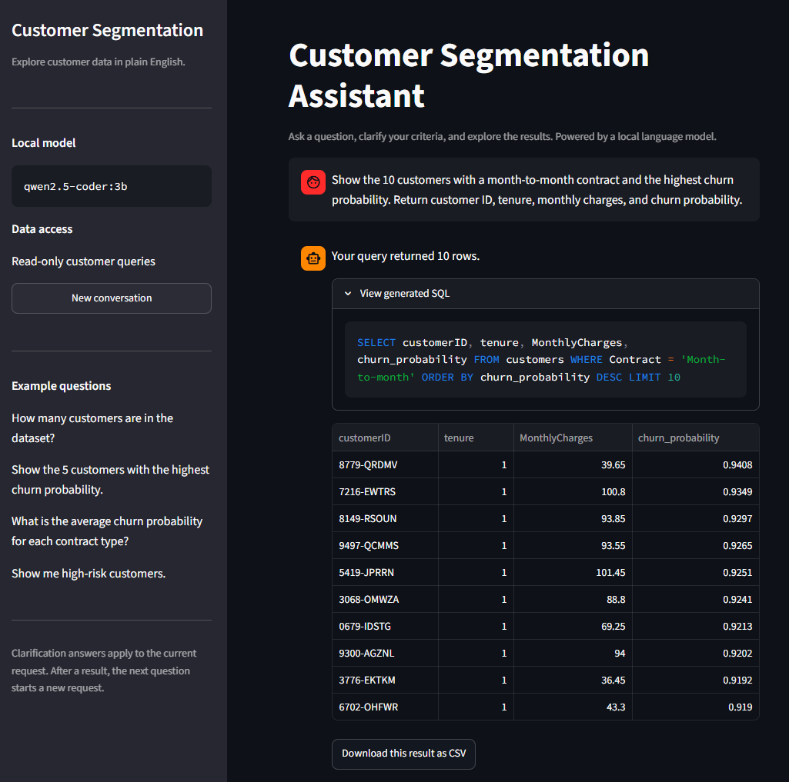
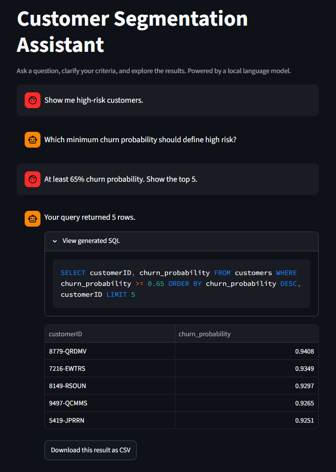
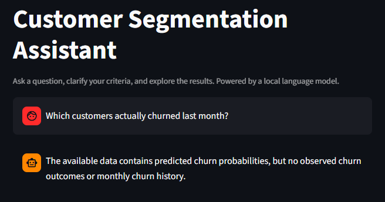
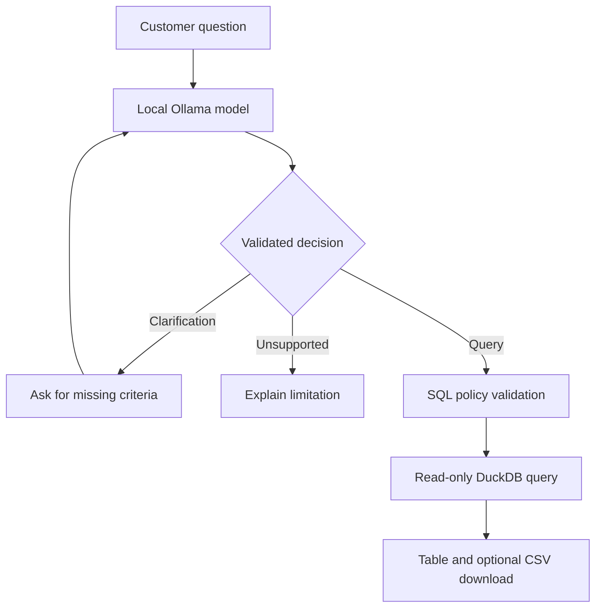

# Customer Segmentation Assistant

Explore customer data and churn predictions through a local chat interface.

Ask questions in English, clarify ambiguous criteria, inspect the generated SQL,
and download query results as CSV. The assistant runs locally using Ollama,
DuckDB, and Streamlit. No external LLM API account is required.

## Demo

### Find customer segments

Ask for a customer segment using contract types, churn probabilities,
monthly charges, tenure, or other available attributes.

The interface displays the generated SQL alongside the query result.



### Clarify ambiguous requests

Risk categories have no predefined thresholds. When asked for
“high-risk customers,” the assistant requests a definition before querying.

For example:

- **Question:** Show me high-risk customers.
- **Clarification:** Which minimum churn probability should define high risk?
- **Answer:** At least 65% churn probability. Show the top 5.
- **Result:** The five highest-scoring customers whose predicted churn
  probability is at least 65%.



### Explain data limitations

The assistant distinguishes predicted churn risk from observed churn events.
When a question requires unavailable information, it explains the limitation.



## Features

- Local browser-based chat interface and command-line interface
- English questions translated into structured assistant decisions
- Clarification questions for ambiguous customer criteria
- Explicit responses for unsupported requests
- SQL validation before database execution
- Read-only DuckDB connections
- Queries restricted to the `customers` table and a supported SQL subset
- Inspectable SQL and tabular results
- CSV downloads initiated by the user
- Reference evaluation based on query results rather than SQL text

## How it works

The language model interprets the request and proposes a decision.
For query decisions, DuckDB executes the validated SQL and computes the result.



The model does not calculate the returned metrics or generate result rows.
Customer records are queried locally and are not included in the model prompt.

### Decision types

| Type | Behavior |
| --- | --- |
| `query` | Validate the proposed SQL and execute it against the customer database |
| `clarification` | Ask for missing criteria before generating a query |
| `unsupported` | Explain that the request requires unavailable data or capabilities |

### Customer-list behavior

- Risk thresholds must be provided by the user.
- Without an explicit customer count, return all matching customers.
- Requests such as “top 5” apply the requested limit.
- Requests for “all” matching customers omit the limit.

These are instructions to the model. SQL policy validation checks permitted
operations, but does not independently verify that every criterion was
interpreted correctly.

## Technology

| Component | Technology |
| --- | --- |
| Language model | `qwen2.5-coder:3b` |
| Local model serving | Ollama |
| Web interface | Streamlit |
| Query engine | DuckDB |
| SQL parsing and validation | SQLGlot |
| Data handling | pandas and PyArrow |
| Environment and dependencies | uv |
| Tests and linting | pytest and Ruff |

## Data

The development dataset contains **6,734 customer records** exported from
a separate customer churn prediction project.

Customer attributes are combined with:

- Predicted churn probability
- Recommended retention action
- Estimated customer value and action value
- Scoring timestamp
- Model name, model version, training run ID, and serving release ID

The recorded export uses model version **5** of
`churn-prediction-model-dev`.

The observed `Churn` label is excluded. Ten records have missing
`TotalCharges` values, represented as SQL NULL.

These scores serve as demonstration inputs. This project does not evaluate
the predictive performance of the upstream churn model.

Customer datasets, database files, and generated exports are excluded
from Git. The README screenshots show selected demonstration results.

## Requirements

- Python 3.12
- uv
- Ollama
- The `qwen2.5-coder:3b` model
- A compatible customer dataset

The application expects Ollama at `http://localhost:11434`.

## Setup

Run all project commands from the repository root.

### 1. Install dependencies

```bash
uv sync
```

### 2. Prepare the local model

Install Ollama using the instructions at
[ollama.com](https://ollama.com/), then download the model:

```bash
ollama pull qwen2.5-coder:3b
```

If Ollama is not already running as a service, start it in a separate terminal:

```bash
ollama serve
```

Check availability:

```bash
curl -sS http://localhost:11434/api/tags
```

### 3. Provide the dataset

Place the upstream customer export at:

```text
data/customer_segmentation.parquet
```

The dataset is not bundled with this repository. It must contain the
columns described in:

```text
src/customer_segmentation_assistant/prompts.py
```

The upstream churn service is not required once the scored dataset has
been exported.

### 4. Create the database

Run this once to import the Parquet dataset:

```bash
uv run python - <<'PY'
from pathlib import Path

import duckdb

source = Path("data/customer_segmentation.parquet")
database = Path("data/customers.duckdb")

if not source.is_file():
    raise SystemExit(f"Missing dataset: {source}")

if database.exists():
    raise SystemExit(f"Database already exists: {database}")

with duckdb.connect(str(database)) as connection:
    connection.execute(
        "CREATE TABLE customers AS SELECT * FROM read_parquet(?)",
        [str(source)],
    )
    count = connection.execute(
        "SELECT COUNT(*) FROM customers"
    ).fetchone()[0]

print(f"Created {database} with {count} customers.")
PY
```

## Web interface

Start the application:

```bash
uv run streamlit run streamlit_app.py \
  --server.address 127.0.0.1 \
  --server.port 8502
```

Open **http://localhost:8502**.

### Example questions

```text
How many customers are in the dataset?
```

```text
Show the 10 customers with a month-to-month contract and the highest churn probability. Return customer ID, tenure, monthly charges, and churn probability.
```

```text
What is the average churn probability for each contract type?
```

```text
How many customers have been with the company for at least 24 months and have a churn probability below 20%?
```

### Clarification workflow

Ask:

```text
Show me high-risk customers.
```

When prompted for a threshold, answer:

```text
At least 65% churn probability. Show the top 5.
```

The assistant combines the original request with the clarification answer.

Up to three clarification answers are accepted for one request.
After a completed query, the next question starts a new request.
References to previous results, such as “show more of those,” are not
currently supported.

Use **New conversation** to clear the displayed chat and pending
clarification context. Chat history is held in browser-session state
and is not persisted across sessions.

### Inspect and download results

Expand **View generated SQL** to inspect the query.

Click **Download this result as CSV** to download the displayed result.
The web interface prepares CSV content in memory; it does not automatically
write an export file into the project directory.

## Command-line interface

Count customers:

```bash
uv run python -m customer_segmentation_assistant.cli \
  "How many customers are in the dataset?"
```

Query a ranked segment:

```bash
uv run python -m customer_segmentation_assistant.cli \
  "Show the 5 customers with the highest churn probability."
```

Start a clarification workflow:

```bash
uv run python -m customer_segmentation_assistant.cli \
  "Show me high-risk customers."
```

Each CLI invocation starts a new conversation.

For non-empty results, the CLI offers a CSV export:

- Enter `y` to save the result under `data/exports/`.
- Press Enter to skip the export.

The CLI exporter refuses to overwrite an existing destination file.

## Validation and evaluation

### Automated checks

```bash
uv run ruff check src tests streamlit_app.py scripts/evaluate_assistant.py
uv run pytest -q
```

Tests cover areas including structured decision parsing, permitted database
queries, rejected SQL operations, and CSV export behavior.

The browser workflow is also checked manually.

### Local-model evaluation

```bash
uv run python scripts/evaluate_assistant.py
```

The latest reported evaluation run passed **9 of 9 reference cases**.

The cases cover:

- Customer counts
- Combined filters and percentage thresholds
- Missing values
- Grouped aggregates
- Ranked customer lists
- Ambiguous risk categories
- Query generation after a clarification answer

Query evaluation compares returned values while ignoring output aliases.
Row order is checked when required by the reference case.

For the standalone clarification case, the response type is checked
automatically and the wording is reviewed manually.

Unsupported responses have been checked manually through the interface;
they are not included in the nine reference cases.

This is a small development evaluation suite. Several cases appear in the
prompt or informed prompt changes, so the results are not an independent
measure of general accuracy.

## Supported SQL scope

The current policy permits a limited subset of SQL, including:

- A single SELECT statement against the unqualified `customers` table
- Column selection and aliases
- Comparisons and logical filters
- NULL checks, IN, BETWEEN, and LIKE
- COUNT, AVG, SUM, MIN, and MAX
- GROUP BY, ORDER BY, DISTINCT, and LIMIT

Joins, subqueries, CTEs, unions, window functions, external data sources,
and unsupported functions are rejected.

## Limitations

- One customer table and one scored dataset
- No observed churn outcomes or event history
- No historical score analysis
- No external information retrieval
- No predefined risk-category thresholds
- No persistent conversation history
- No follow-up modifications to completed queries
- Local application; no publicly deployed service

SQL validation and read-only access restrict supported operations.
They do not guarantee that accepted SQL correctly represents the user's intent.
Generated SQL is displayed for inspection.

Local inference latency depends on hardware, model loading, prompt
processing, and system load. The first request can be substantially slower.

The application is a portfolio prototype. Broader evaluation and additional
operational controls would be needed before production use.

## Project structure

```text
streamlit_app.py
src/customer_segmentation_assistant/
    cli.py
    database.py
    decisions.py
    export.py
    llm.py
    prompts.py
    sql_policy.py
evaluation/
    cases.json
scripts/
    evaluate_assistant.py
tests/
docs/images/
```

| File | Purpose |
| --- | --- |
| `streamlit_app.py` | Browser-based chat interface |
| `cli.py` | Terminal workflow |
| `database.py` | Validated read-only database access |
| `decisions.py` | Structured response parsing |
| `export.py` | CLI CSV export |
| `llm.py` | Local Ollama integration |
| `prompts.py` | Table description and assistant instructions |
| `sql_policy.py` | Supported SQL policy |
| `evaluation/cases.json` | Reference questions and expected queries |
| `scripts/evaluate_assistant.py` | Local-model evaluation |
| `tests/` | Automated tests |
| `docs/images/` | Demonstration screenshots |