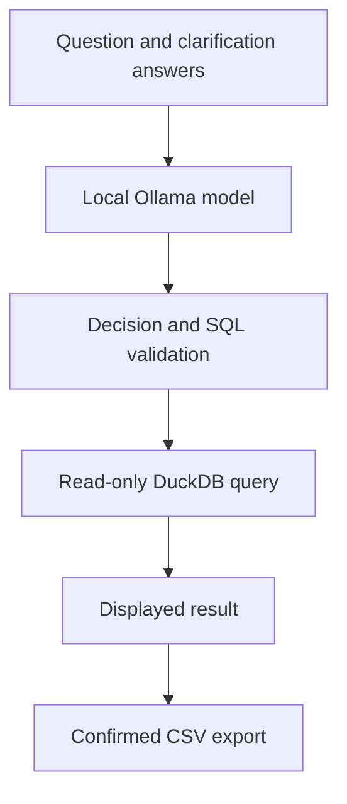

# Customer Segmentation Assistant

A local natural-language interface for exploring customer churn data.

The assistant translates English questions into validated DuckDB SQL,
asks for clarification when requirements are ambiguous, and queries
customer data with model-generated churn scores.

Language generation runs locally through Ollama. No external LLM API
account is required.

## Example workflow

```text
Question:
Show me high-risk customers.

Assistant:
Which minimum churn probability defines high risk?

User:
At least 70% churn probability. Show the top 5.

Generated SQL:
SELECT customerID, churn_probability
FROM customers
WHERE churn_probability >= 0.7
ORDER BY churn_probability DESC, customerID
LIMIT 5
```

The CLI displays the query result and offers a CSV export.
An export is created only after explicit confirmation.

## Features

- English questions translated into structured query or clarification decisions
- Follow-up answers used to resolve ambiguous requests
- SQL validation before execution
- Read-only DuckDB connections
- Queries restricted to the `customers` table and a supported SQL subset
- Local model inference using `qwen2.5-coder:3b`
- CSV export of displayed results after confirmation
- Protection against overwriting existing export files
- Reference evaluation comparing query results rather than SQL strings

## Architecture



The model proposes SQL. DuckDB executes the accepted query and computes
the result. The model does not calculate the returned business metrics.

## Data

The development dataset contains 6,734 customer records exported from a
separate churn prediction project.

It combines customer attributes with:

- Churn probability
- Recommended retention action
- Estimated customer value and action value
- Scoring timestamp
- Model name, version, run ID, and serving release ID

The observed `Churn` label is excluded. Ten records have missing
`TotalCharges` values, represented as SQL NULL.

The scores are demonstration inputs. This project does not measure
the predictive performance of the upstream churn model.

Customer data, database files, and exports are excluded from Git.

## Requirements

- Python 3.12
- uv
- Ollama running locally at `http://localhost:11434`
- The `qwen2.5-coder:3b` model
- A compatible customer dataset

## Setup

From the repository root:

```bash
uv sync
ollama pull qwen2.5-coder:3b
```

If Ollama is not already running as a service, start it in another terminal:

```bash
ollama serve
```

Place the upstream export at:

```text
data/customer_segmentation.parquet
```

The dataset is not bundled with this repository. It must contain the
columns described in `src/customer_segmentation_assistant/prompts.py`.

Create the local database once:

```bash
uv run python - <<'PY'
from pathlib import Path

import duckdb

source = Path("data/customer_segmentation.parquet")
database = Path("data/customers.duckdb")

if not source.is_file():
    raise SystemExit(f"Missing dataset: {source}")

if database.exists():
    raise SystemExit(f"Database already exists: {database}")

with duckdb.connect(str(database)) as connection:
    connection.execute(
        "CREATE TABLE customers AS SELECT * FROM read_parquet(?)",
        [str(source)],
    )
    count = connection.execute(
        "SELECT COUNT(*) FROM customers"
    ).fetchone()[0]

print(f"Created {database} with {count} customers.")
PY
```

## Usage

Run commands from the repository root.

Count customers:

```bash
uv run python -m customer_segmentation_assistant.cli \
  "How many customers are in the dataset?"
```

Find a ranked customer segment:

```bash
uv run python -m customer_segmentation_assistant.cli \
  "Show the 5 customers with the highest churn probability."
```

Start a clarification workflow:

```bash
uv run python -m customer_segmentation_assistant.cli \
  "Show me high-risk customers."
```

Example answer to the clarification:

```text
At least 70% churn probability. Show the top 5.
```

When prompted to export, enter `y` to create a CSV under `data/exports/`.
Press Enter to skip the export.

Each CLI invocation starts a new conversation. Up to three clarification
answers are accepted within one invocation.

## Validation and evaluation

Run linting and automated tests:

```bash
uv run ruff check src tests scripts/evaluate_assistant.py
uv run pytest -q
```

Run the local-model evaluation:

```bash
uv run python scripts/evaluate_assistant.py
```

The current development checkpoint has:

- 40 passing automated tests
- 9 passing reference evaluation cases in the latest recorded run

Reference cases cover counts, filters, grouping, ranking, missing values,
and a clarification followed by a query.

Query evaluation compares result values while ignoring output aliases.
Row order is checked when required by the reference case.

The standalone clarification case checks the decision type automatically;
the relevance of its wording is reviewed manually.

These cases are a small development suite. Several also appear in the
prompt or informed prompt changes, so the results are not an independent
measure of general accuracy.

## Supported scope and limitations

- One customer table
- Basic filtering, aggregation, grouping, and ranking
- No joins, CTEs, subqueries, unions, or window functions
- No predefined high-, medium-, or low-risk thresholds
- No event history or historical score analysis
- No persistent conversation history
- No web interface or deployed service

SQL validation and read-only access restrict supported operations.
They do not guarantee that a valid query correctly represents the user's
intent. Generated SQL is displayed for inspection.

Local inference latency varies with model loading, prompt processing,
and available hardware. The first request can be substantially slower.

## Project structure

- `src/customer_segmentation_assistant/cli.py`: terminal workflow
- `src/customer_segmentation_assistant/llm.py`: local Ollama integration
- `src/customer_segmentation_assistant/prompts.py`: schema and instructions
- `src/customer_segmentation_assistant/decisions.py`: response validation
- `src/customer_segmentation_assistant/sql_policy.py`: supported SQL policy
- `src/customer_segmentation_assistant/database.py`: database queries
- `src/customer_segmentation_assistant/export.py`: CSV export
- `evaluation/cases.json`: reference questions and expected queries
- `scripts/evaluate_assistant.py`: local-model evaluation
- `tests/`: automated tests