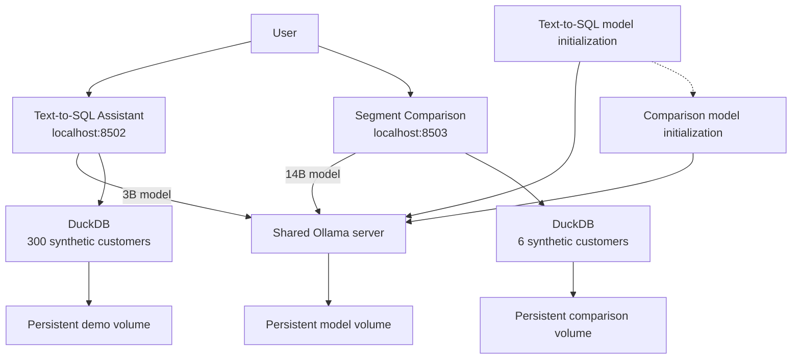
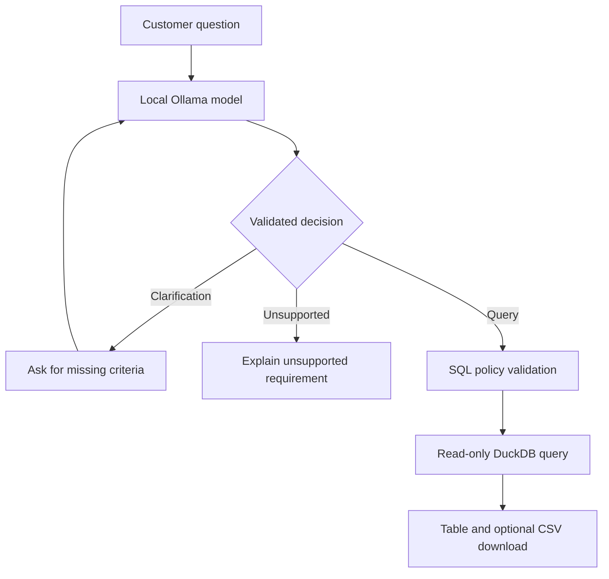
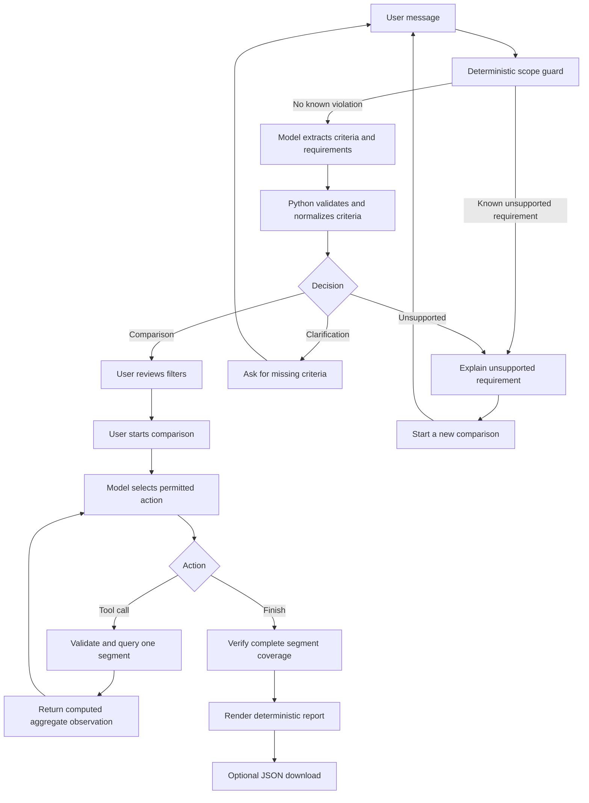

# Architecture and implementation

[Back to project overview](../README.md)

## Architecture

### Docker deployment



Both applications use the same project image configuration and
share the Ollama server.

Their datasets are stored separately in persistent volumes.

Two sequential model initialization services download the
configured language models before the dependent applications start.

Both models are stored in the same persistent Ollama volume.
The applications can select different models independently.

### Text-to-SQL execution flow



The language model interprets the user's request and proposes
a structured decision.

Python validates the decision and generated SQL before DuckDB
executes the query.

The model does not calculate the returned metrics or generate
customer result rows.

Individual customer records are queried locally and are not
included in the model prompt.

#### Decision types

| Decision | Behavior |
| --- | --- |
| `query` | Validate and execute generated SQL |
| `clarification` | Request missing criteria |
| `unsupported` | Explain unavailable data or unsupported capabilities |

### Bounded comparison execution flow



The comparison workflow separates language understanding from
scope validation, data access, execution control and numerical
computation.

| Responsibility | Implementation |
| --- | --- |
| Detect known unsupported requirements | Deterministic Python scope guard |
| Interpret natural language | LLM |
| Extract comparison criteria | LLM |
| Identify additional unsupported requirements | LLM |
| Validate and normalize probability thresholds | Python |
| Retain conversation criteria | Python |
| Confirm recognized comparison criteria | User |
| Select a permitted next action | LLM |
| Restrict available actions | Python |
| Execute aggregate queries | DuckDB |
| Verify execution completeness | Python |
| Generate the final report | Python |

The scope guard checks both initial requests and clarification
answers before model-based extraction.

Known unsupported requirements can therefore be rejected without
model inference or database queries.

The model additionally identifies unsupported requirements that
are not covered by the deterministic rules.

Extracted probability thresholds are validated and rounded to
12 decimal places to remove numerical artifacts such as
`0.7000000000000001` instead of `0.7`.

This normalization also prevents equivalent thresholds from
being interpreted as different comparison conditions.

The scope guard provides an additional validation layer, not
a complete natural-language verification system.

The model receives computed aggregate observations after each
tool call. It does not receive individual customer rows in
the comparison loop.

#### Controlled tool execution

Python restricts the available action schema according to
the current execution state:

- While segments remain, only a tool call for an outstanding
  contract is permitted.
- When all segments have been queried, only the completion
  signal is permitted.

Independent execution checks reject:

- Duplicate segment queries.
- Out-of-scope actions.
- Invalid tool arguments.
- Premature completion.
- Exceeded execution limits.

The interface permits at most four tool calls.

With this configuration, the loop permits at most five
planner calls, including completion.

Each model request uses the configurable `OLLAMA_TIMEOUT_SECONDS` network timeout (default: 180 seconds).
This is not a total workflow deadline.

#### Deterministic reporting

The final report is rendered by Python from computed
aggregate values.

An earlier free-text reporting experiment produced incorrect
comparisons and invented currency information. That experiment
is not used to generate comparison reports.

For this fixed comparison task, deterministic orchestration
could execute the same queries without model-based action
selection.

The model-selected query order does not provide an analytical
advantage. The purpose of this implementation is to demonstrate
controlled tool execution, state-dependent actions and
verifiable completion.

## Package structure

```text
src/customer_segmentation_assistant/
├── config.py
├── cli.py
├── llm/           # client, exceptions, error_messages
├── text_to_sql/   # assistant, decisions, prompts, row_limits
├── comparison/    # request, scope, conversation, agent
├── segments/      # criteria, extraction, conversation, dispatch, tools
├── storage/       # database, sql_policy, export
├── demo/          # text_to_sql, comparison
├── experiments/   # result_summary
└── ui/            # theme
```

| Component | Responsibility |
| --- | --- |
| `config.py` | Shared model, endpoint and timeout configuration |
| `llm/client.py` | Structured Ollama generation; HTTP, timeout and response validation |
| `llm/exceptions.py`, `llm/error_messages.py` | Typed failures and actionable interface messages |
| `text_to_sql/assistant.py` | Structured decisions and result-limit enforcement |
| `text_to_sql/decisions.py`, `prompts.py`, `row_limits.py` | Decision parsing, schema instructions and explicit count rules |
| `comparison/request.py`, `scope.py` | Extraction, normalization and known unsupported requirement checks |
| `comparison/conversation.py`, `agent.py` | Criteria state, bounded execution and deterministic reports |
| `segments/criteria.py` | Shared contract and probability validation; no database or model dependencies |
| `segments/extraction.py`, `conversation.py` | Single-segment extraction and clarification |
| `segments/dispatch.py`, `tools.py` | Allowlisted tool dispatch and parameterized aggregates |
| `storage/` | Read-only database access, SQL policy and exports |
| `demo/` | Reproducible synthetic datasets |
| `experiments/result_summary.py` | Isolated model-written explanation experiment, not used in either UI report |
| `ui/theme.py` | Shared visual styling |

Both root Streamlit entrypoints and the CLI use the same application package. All five model integrations use the common Ollama client, which rejects incomplete outer responses and exposes typed connection, timeout, HTTP and response errors. No automatic retries are performed.

Model-extracted probabilities are rounded to 12 decimal places after validation. Direct analytical tool arguments retain their numerical precision. The shared criteria module has no model or database dependencies.

## Repository organization

- `streamlit_app.py`, `streamlit_agent_demo.py`: web entrypoints.
- `compose.yaml`, `Dockerfile`: local deployment.
- `.streamlit/config.toml`: native theme settings.
- `tests/unit/`, `tests/integration/`, `tests/integration/ui/`: software verification.
- `evaluation/`, `scripts/evaluate_*.py`, `scripts/check_comparison_dialogue.py`: live-model reference checks.
- `scripts/smoke/`: reusable model-free deployment checks.
- `.github/workflows/ci.yml`: CI orchestration.
- `docs/`: documentation, screenshots and original case studies.
