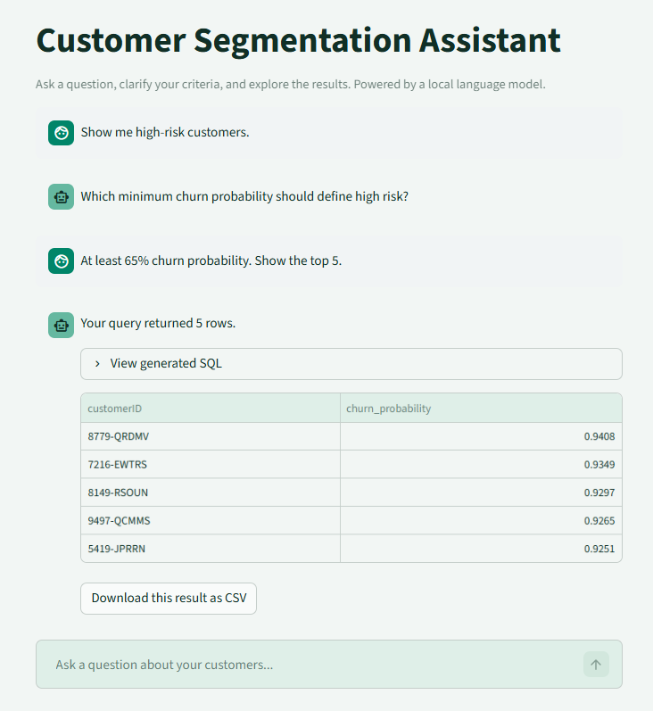
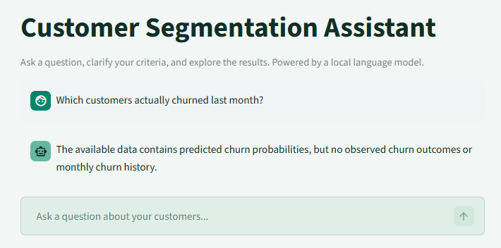

# Application usage

[Back to project overview](../README.md)

## Using the Text-to-SQL Assistant

### Example questions

```text
How many customers are in the dataset?
```

```text
Show the 10 customers with a month-to-month contract and the highest churn probability. Return customer ID, tenure, monthly charges, and churn probability.
```

```text
What is the average churn probability for each contract type?
```

```text
How many customers have been with the company for at least 24 months and have a churn probability below 20%?
```

```text
How many customers have missing total charges?
```

### Clarification workflow

Ask:

```text
Show me high-risk customers.
```

When prompted, answer:

```text
At least 65% churn probability. Show the top 5.
```

The assistant combines the original request with the
clarification answer.

Up to three clarification answers are accepted for one request.

After a completed query, the next question starts a new request.
References to previous results, such as "show more of those",
are not supported.

Select **New conversation** to clear the displayed conversation
and pending clarification context.

Conversation history is stored in Streamlit session state
rather than durable storage.





The screenshots use the original scored development dataset, not the synthetic Docker data.

### Result-limit enforcement

Risk thresholds must be explicitly supplied by the user.

Without an explicit customer count, the application returns
all matching customers.

Python removes the model-generated LIMIT and applies the
count recognized from the customer's messages.

Supported English count phrases include:

- `top 5`, `bottom 5`, `first 5`, `last 5`
- `show 5 customers`
- `return 5 rows`
- `limit to 5`
- `all matching customers`
- `no limit`

A count supplied before clarification is retained unless a
later customer message supplies a different count or explicitly
requests all matching results.

Assistant clarification messages are excluded from count
extraction.

Conflicting counts within one message trigger clarification.

Spelled-out numbers such as `five` and unsupported count
formulations are not recognized by this rule.

This mechanism controls result counts only. Filter
interpretation, selected columns and ranking direction
still depend on generated SQL.

### Inspect and download results

Expand **View generated SQL** to inspect the generated query.

Select **Download this result as CSV** to download the
displayed result.

CSV content is prepared in memory. The web interface does not
automatically write result exports into the project directory.

### Supported SQL scope

The Text-to-SQL policy permits:

- A single SELECT against the unqualified `customers` table.
- Column selection and aliases.
- Comparisons and logical filters.
- NULL checks.
- IN, BETWEEN and LIKE.
- COUNT, AVG, SUM, MIN and MAX.
- GROUP BY.
- ORDER BY.
- DISTINCT.
- LIMIT.

Unsupported operations include:

- Joins.
- Subqueries.
- Common table expressions.
- Unions.
- Window functions.
- External data sources.
- Unsupported SQL functions.
- Data modification.

Queries execute through read-only DuckDB connections.

SQL validation restricts permitted operations but does not
guarantee that a generated query represents the user's intent.

Generated SQL remains visible for inspection.

## Using the bounded comparison demo

### Supported comparison scope

The comparison application supports:

- Two or three explicitly named contract types.
- One shared inclusive minimum predicted churn probability.
- Customer counts.
- Average monthly charges.
- Average predicted churn probabilities.

Supported contract types:

```text
Month-to-month
One year
Two year
```

The comparison tool uses fixed parameterized aggregate SQL
rather than SQL generated by the model.

Known unsupported requirements are checked by a deterministic
scope guard before model-based extraction.

Examples include:

- Customer tenure conditions.
- Filters on monthly charges.
- Additional customer attributes such as age, gender or payment method.

For example:

```text
Compare monthly and annual contracts with churn probability
at least 60%, but only customers with tenure of at least 24 months.
```

The request is rejected because the comparison application
does not support customer tenure filters.

The scope guard also checks clarification answers.

Additional unsupported requirements are checked during
model-based criteria extraction.

These checks reduce the risk of silently ignored conditions
but cannot guarantee complete interpretation of arbitrary
natural-language requests.

### Example dialogue

Enter:

```text
Compare monthly and annual contracts.
```

When prompted for the missing threshold:

```text
Use a minimum churn probability of 80%.
```

Review the recognized filters and select
**Run this comparison**.

Expected results for the bundled synthetic fixture:

| Contract | Matching customers | Average monthly charges | Average predicted churn probability |
| --- | ---: | ---: | ---: |
| Month-to-month | 1 | 60.00 | 80% |
| One year | 1 | 70.00 | 85% |

### Inspect execution

The interface provides:

- Recognized comparison criteria.
- An explicit execution button.
- Model actions.
- Aggregate tool observations.
- The computed report.
- Completed tool-call count.
- Downloadable JSON results.

Numerical results are computed by DuckDB and formatted by
Python rather than generated by the language model.

### Conversation behavior

Criteria persist within the comparison conversation.

Values omitted from a follow-up retain previous values.
A new message clears the previous report, actions and executable decision, but does not automatically clear the comparison criteria. A failed extraction does not leave the previous confirmation button available.

When at least two contracts are known and the threshold is
missing, a follow-up is treated as a threshold answer.
The existing contract selection is preserved.

Select **New comparison** to:

- Clear previous criteria.
- Reset the conversation.
- Remove previous model actions and reports.
- Start with a different contract selection.

New requests and follow-ups are not automatically
distinguished.

Results are queried only after the user selects
**Run this comparison**.

Unsupported requirements block comparison execution for
the current conversation.

The interface explains the unsupported requirement instead of
offering an execution button.

Select **New comparison** to start a separate supported request.

### Download results

Select **Download computed results** to download the
comparison result as JSON, including the associated
tool observations.

## Command-line interface

The CLI operates on the selected Text-to-SQL dataset.

Example:

```bash
uv run customer-segmentation-assistant \
  "How many customers are in the dataset?"
```

With the synthetic dataset:

```bash
CUSTOMER_DATABASE=data/text_sql_demo.duckdb \
uv run customer-segmentation-assistant \
  "Show the 5 customers with the highest churn probability."
```

Clarification example:

```bash
uv run customer-segmentation-assistant \
  "Show me high-risk customers."
```

Each invocation starts a new conversation.

For non-empty results, enter `y` to save a CSV file under
`data/exports/`, or press Enter to skip.

The exporter refuses to overwrite an existing destination.

Model communication failures produce actionable messages; the CLI exits with status 1 for these failures.
